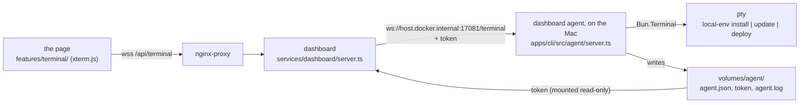
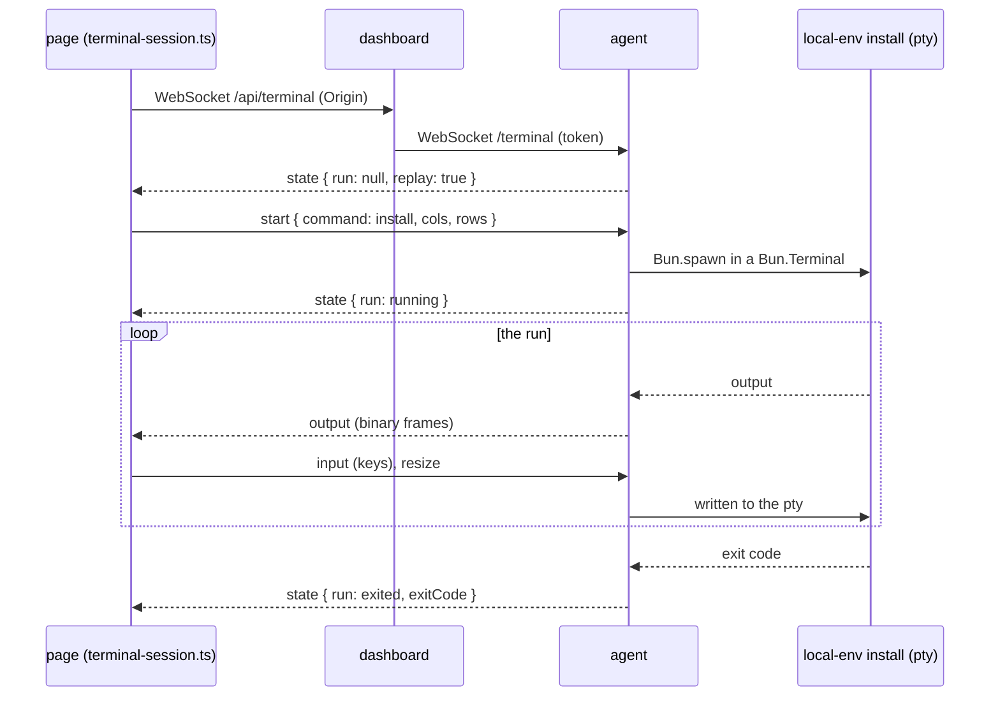

# Dashboard terminal

Status: done. `local-env install`, `update` and `deploy`, started from the
dashboard and shown in a terminal in the page.

## What it does

- The Tools and Profiles pages have an **Install** button, there at any time:
  also when nothing waits, to run the install again. When something waits, the
  button opens the install dialog first, and the dialog's **Install** runs it
  ([Tools and profiles](tools-and-profiles.md)).
- **Update** is in the menu of the version, at the bottom of the sidebar
  (`features/layout/nav-version/`), on every page: update is for the whole of
  local-env, not for one page. When a new release is out, the version shows an
  **Update** badge, and the menu's **Update to v…** opens a dialog: the new
  version, the command, and an **Update** button. Otherwise, **Update** runs at
  once: it also pulls the sources and refreshes the stacks.
- The Docker page's **Deploy** button, on each template, runs
  `local-env deploy <template>` ([Docker catalog](docker-catalog.md)).
- Each of these opens a terminal in a side sheet and runs the command on the
  Mac. Above the terminal, the sheet shows the command, to copy and run in a
  terminal instead.
- When a run ends, a toast says so, on any page and with the sheet closed: green
  when it worked, red with the exit code when it failed. Its **Show** button
  opens the terminal (`features/terminal/run-toast/`), unless the terminal is
  open already.
- The terminal is a real terminal. The user types in it to answer the questions
  of the command: a select, a confirmation, the sudo password.
- The sheet stays open when the user goes to another page. Closing the sheet
  does not stop the command. Opening it again shows the command from its start.
- During `update`, the dashboard restarts. The terminal shows **Reconnecting**,
  then shows the command again and goes on.
- One command runs at a time. During its run, the Install button and the version
  menu say "Installing…" or "Updating…" and open the terminal.
- The **dashboard agent** runs the commands. It is a process on the Mac.
  `local-env start` starts it, and `local-env stop` and `local-env reset` stop
  it. `local-env status` and `local-env doctor` say whether it runs.
- Without the agent, the buttons are not there or are disabled. The install
  dialog gives the command to run in a terminal, and says to run
  `local-env start`.
- After a restart of the Mac, nothing of local-env runs until `local-env start`.
  The core services do not restart by themselves (`restart: 'no'` in
  `compose.yaml`).

## How it works

### The parts

- `apps/cli/src/core/agent.ts` starts and stops the agent. `local-env start`
  calls `ensureAgent()`: it keeps an agent of this version that answers, or
  stops the old one and starts `local-env agent`, detached, in its own session.
  The agent's output goes to `volumes/agent/agent.log`.
- `local-env agent` (`apps/cli/src/commands/agent.ts`, hidden from `--help`)
  writes a new random token to `volumes/agent/token` (mode 600) and its pid,
  port and version to `volumes/agent/agent.json`. It listens on
  `127.0.0.1:17081` (`LOCAL_ENV_AGENT_PORT` in tests).
- The agent answers only requests with its token (`Authorization: Bearer`).
  `GET /status` gives its version and the current or last run. `GET /terminal`
  opens a WebSocket on the run.
- The dashboard has the token: `compose.yaml` mounts `volumes/agent` into the
  dashboard alone. The dashboard checks the `Origin` of `/api/terminal`: only
  `https://local-env.<domain>` can connect. Then it pipes the page's socket to
  the agent's socket.
- The `agent` topic of `/api/events` gives `{ available, version, run }`. The
  dashboard asks the agent for its status every 3 seconds while a page is open,
  and when the token file changes.
- `services/dashboard/agent-protocol.ts` (no imports) holds the messages. The
  agent, the dashboard and the page use it.

### One run

- The agent keeps the last 1 MB of the run's output. A socket that connects
  during or after the run gets `state { replay: true }` and then this output.
  The page clears its terminal and writes it again. This is how a reload, a
  second tab and the restart of the dashboard during `update` work.
- The page sends `start` only after the first `state`. If the same command
  already runs, the page shows it. If another command runs, the page shows an
  error. The agent also refuses a second run.
- `terminal-session.ts` opens the socket when the sheet opens and closes it when
  the sheet closes. It tries again after a drop (0.5 s, 1 s, 2 s, then every 5
  s) while the sheet is open.
- `xterm-view/` loads xterm.js with `React.lazy`, so no other page loads it.

### A new version

`update` can upgrade local-env with Homebrew while the agent runs it. After each
run, the agent runs `local-env --version`. If the version is different, it
starts the new agent and exits. It never stops during a run. `local-env start`
also replaces an agent of another program, unless that agent runs a command:
`agent.json` records which one it runs (`build`: the command that runs local-env
and, for a binary, the size and the time of its file). The version alone is not
enough: a checkout and Homebrew have the same one until a release, and a binary
built again keeps it. An agent that wrote no `build` (an older local-env) is
replaced too.

The agent starts commands with Homebrew's link (`/opt/homebrew/bin/local-env`),
not the Cellar path of its own version. `brew upgrade` puts the new version
behind the link, and `brew cleanup` removes the old Cellar folder.

- A run of the agent has `LOCAL_ENV_FROM_DASHBOARD=1`. The CLI logs in to no AWS
  or Vault account then: a login opens a browser or asks for a password, which
  belongs in the user's own terminal ([Logins](logins.md)). The install stops
  with the command to run.

## Why

- **A process on the Mac, not the dashboard.** The dashboard runs in a
  container. The commands need the Mac, the user, Homebrew, Ansible and
  sometimes sudo. Docker Desktop, code-server and ttyd work the same way: a
  process on the host owns a pty, and the page shows it with xterm.js.
- **A pty, not a new UI for the commands.** In a pty, the CLI sees a terminal.
  Its questions, its spinners and the sudo password work as they do in a
  terminal. The dashboard needs no copy of the prompts of `install` and
  `update`.
- **Three commands only.** The agent runs `install`, `update` or `deploy`, never
  a command that the page sends. `deploy` takes one argument, a template id that
  `runArguments` (`services/dashboard/agent-protocol.ts`) checks against
  `<source>/<folder>`, and the agent adds `--yes` (the Deploy button was the
  question). A page that gets the socket cannot run a shell.
- **A token and an Origin check.** Browsers do not apply CORS to WebSockets, so
  any web site could open a socket to the dashboard: the dashboard checks the
  `Origin`. Any container can reach `host.docker.internal`, so the agent wants
  the token. The token is in a file that only the user and the dashboard can
  read. It changes each time the agent starts.
- **`local-env start` starts the agent, not launchd.** A LaunchAgent restarts
  the agent after a crash and a reboot, but it is one more file on the Mac. It
  stays after `brew uninstall`, and it starts a binary that is gone. A Homebrew
  service needs changes to the tap and does not work for a checkout. With the
  core services set to `restart: 'no'`, the agent and the services always run
  together: `local-env start` starts both.
- **The run lives in the agent, not in the socket.** `update` restarts the
  dashboard and nginx. A run that ends with its socket would stop the update
  halfway. The replay also lets a reload or a second tab show the run.
- **A dark terminal in both themes.** The CLI's colors are made for a dark
  terminal.

## Limits

- One command runs at a time, from the dashboard. The agent does not know about
  a `local-env install` that runs in a terminal at the same time.
- Nothing restarts a core service or the agent after a crash. `local-env status`
  and `local-env doctor` show it, and `local-env start` brings them back.
- The page does not keep the output after the agent stops: `local-env stop` ends
  a run.
- Only the last 1 MB of a run's output is replayed.
- `install <profile>` and the options (`--yes`, `--dry-run`) do not run from the
  dashboard. The profile comes from the Profiles page.
