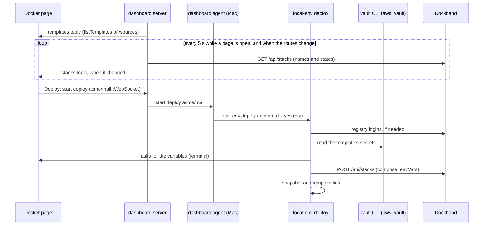

# Docker catalog

Status: done. The Docker templates of the sources, deployed from the dashboard
or with `local-env deploy`, with their registry logins, their variables and
their secrets from the vault.

## What it does

- The dashboard's **Docker** page lists the stack templates of every source as
  cards: the title, description, logo and categories of `templates.json`, and
  what a deploy needs (the variables it asks for, the secrets it reads from the
  vault, the registries of its private images). Like the Tools table, a filter
  bar (a search, then Source, Category and Status, with a chip for each active
  filter) narrows the cards, and pages of 10 to 100 cards follow (50 by
  default).
- A card shows **Deploy**, or once a stack of the template's name exists,
  **Running** with a link to the app, or **Stopped**, and a link to Dockhand.
- Under the cards, **Other apps** lists the routes that no template deployed (a
  stack made in Dockhand, a container started with a `VIRTUAL_HOST`), with how
  to add one. It is not there when every route comes from a template. **Deploy**
  opens the terminal sheet and runs `local-env deploy <source>/<folder>` on the
  Mac ([Dashboard terminal](dashboard-terminal.md)).
- `local-env deploy [template]` does the same in a terminal: a template id, a
  folder or stack name that only one source has, or a pick in a list. `--yes`
  skips the confirmation.
- Dockhand's own Templates page is hidden, and the sources are not listed there.
  The user can show the page again for other catalogs.

## How it works

- `services/dashboard/templates.ts` lists the templates, for the dashboard and
  the CLI: the type 3 entries of each source's `docker/templates.json` whose
  `stackfile` is `docker/<folder>/<compose file>`. A template's id is
  `<source>/<folder>`, its stack is the compose `name:`, else the folder.
  `services/dashboard/catalog.ts` holds its types, with no imports, for the web
  app. `services/dashboard/compose-variables.ts` finds the variables of a
  compose file in the values of its YAML (`Bun.YAML`), as compose does: never in
  a comment.
- What a deploy needs, from the compose file: `${NAME:?help}` without a default
  is asked for, unless the source's `secrets` name it (then it is read from the
  vault); the registries are the source's `registry` logins whose host starts an
  image.
- Deployed is a stack of the template's name in Dockhand's local environment:
  the same rule as the template links. The dashboard server asks Dockhand on its
  network (`http://dockhand:3000`) and streams the answer as the `stacks` topic
  of `/api/events`: every 5 seconds while a page is open, sent only when it
  changed, and at once when the routes change (a stack deployed, stopped or
  removed). A stack removed in Dockhand makes its card deployable again within
  seconds.
- Running or Stopped (`templateStates` in `features/docker/docker.ts`): a
  template with a `VIRTUAL_HOST` runs while the routes, which stream live, have
  one for its stack, and the card links to that route's address. A template
  without one takes Dockhand's state of the stack.
- After a deploy, the CLI prints the app's addresses: its `VIRTUAL_HOST` values,
  with the domain added to a short one, as proxy-connector does.
- `apps/cli/src/commands/deploy.ts` resolves the template, stops when its stack
  exists, then uses `apps/cli/src/providers/docker/stack-deploy.ts`, shared with
  `install` for the stacks a tool needs: `prepareStacks` (registry logins,
  secrets from `stack-secrets.ts`, the asked variables) and `deployStacks`
  (`POST /stacks` with `envVars`, the snapshot and the link, so `sources sync`
  updates it). Only `install` records its stacks in `stacks.json`.
- The provisioning steps hide `/templates` in Dockhand's sidebar
  (`steps/sidebar.ts`, while the sidebar is untouched) and delete the template
  lists that local-env registered there before (`steps/template-sources.ts`).
  `catalog-server` still serves the sources: the build contexts and the compose
  files that the CLI compares with the stacks.

## Why

- **Our own catalog, not Dockhand's Templates page.** A deploy from Dockhand's
  page can't get secrets from the vault. Dockhand gives a stack template only
  its compose file and a name: the template's `env` is dropped. Every way
  Dockhand has to get a secret (a secret variable, a provider's selector, an
  inline reference) lives in the stack's environment, which stays empty. We
  tried to make local-env a Vault, a 1Password Connect and an Infisical provider
  for Dockhand: each works once the stack's environment points at it, and none
  can be reached from the Templates page. Deploying ourselves gives every stack
  its logins, variables, secrets and link from the start.
- **Separate from Tools.** Roles share one set of variables for the whole
  install (`variables.json`); a stack's variables are its own. One table would
  mix the two.
- **A command, run by the agent.** The Deploy button runs the same command as
  the terminal: its questions, the vault login and the output work as in a
  terminal, with no copy of them in the page. `deploy` is apart from `install`:
  it deploys one app once, with no playbook and no sudo, and the stack then
  lives in Dockhand.
- **Deploy once.** A second copy of a template would have the same name, which
  links stacks to templates. To deploy again, the user removes the stack in
  Dockhand.
- **Dockhand polled, while a page is open.** Dockhand has no event stream, and a
  stack removed there must not still show as deployed. One request every 5
  seconds, only while a page listens, as for the dashboard agent; the routes,
  which proxy-connector writes from Docker's events, make the common cases
  immediate.
- **The status on the card, no Routes tab.** A list of routes beside the cards
  showed the same apps twice. The card says whether the app runs and where, and
  only what no template deployed gets a list of its own.
  `local-env proxy routes` still lists every route.
- **Hidden, not removed.** Dockhand's Templates page stays one click away for
  other catalogs, which local-env leaves alone.

## Limits

- The variables are asked in the terminal, not in a form of the page.
- A secret rotated in the vault reaches the stack at the next template change,
  not before.
- Container templates (`"type": 1`) are not in the catalog.
- A stack deployed outside local-env, from Dockhand, has no secrets:
  `sources sync` says so.
- The sidebar step does not hide Templates in a sidebar the user changed.
- A change in Dockhand that touches no route (a template without a
  `VIRTUAL_HOST`) reaches the card at the next tick: up to 5 seconds.
