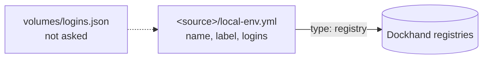

# Logins

Status: done for registries. The logins live in the
[source manifest](source-manifest.md).

## What it does

A **login** is an account that a source needs the user to be signed in to. A
source declares its logins once, in its **manifest**: `local-env.yml` at the
root of the source. local-env checks them, asks the user to log in when one is
missing, and shows their state.

There is one type of login today:

| Type       | For                                      | The credential                                  |
| ---------- | ---------------------------------------- | ----------------------------------------------- |
| `registry` | Private images of the source's templates | A token that the user types. Dockhand keeps it. |

```yaml
# <source>/local-env.yml
name: acme-platform
label: Acme Platform
logins:
  ghcr:
    type: registry
    host: ghcr.io
    usernameHelp: your GitHub username
    tokenHelp: a classic token with read:packages
```

- `name` and `label` belong to the [source manifest](source-manifest.md).
  `logins` maps a login name to a login. A login name is lowercase letters,
  digits and `-`, unique in its source.
- `local-env sources login [source] [--login <name>]` logs in to the logins of a
  source. `local-env sources logout [source] [--login <name>]` logs out. Without
  a source, both list the sources and the state of their logins.
- `local-env sources list` shows if each source with logins is logged in.
  `local-env doctor` checks every login.
- `start` and `sources sync` ask for the missing registry logins.

## How it works

### The files



- `services/dashboard/source-manifest.ts` reads the manifest
  ([Source manifest](source-manifest.md)). This feature uses its `logins`.
- `apps/cli/src/logins/types.ts` defines a `LoginType`: `parse` (the YAML entry
  to a typed login, or an error that names the field), `identity` (the key that
  makes two declarations one account) and `title`.
- `declared.ts` reads the logins of the manifests, by type (`readSourceLogins`,
  `listAccounts`, one entry for each account). `listing.ts` gives the lines of
  `sources list`, `sources login` and `logout`.
- `index.ts` lists the types and checks the logins of a manifest
  (`checkManifestLogins`), for `sources add` and `doctor`.
- `registry.ts` implements the `registry` type.
- `volumes/logins.json` in the home folder keeps the logins that the user does
  not want to be asked about again (by identity).

The identity of each type:

| Type       | Identity             | Two declarations with the same identity… |
| ---------- | -------------------- | ---------------------------------------- |
| `registry` | the host (`ghcr.io`) | share one Dockhand login                 |

### The `registry` type

The code is in `apps/cli/src/logins/registry.ts`: it asks Dockhand if a login of
the host exists, asks for a username and a token, tests them with Dockhand and
saves them there. `registryLoginsStep` is the provisioning step of `start` and
`sources sync`.

- The identity is the full host: `ghcr.io/team-a` and `ghcr.io/team-b` are one
  login, as Docker keeps one login for each host.
- `sources login acme --login ghcr` (the name in the manifest) logs in to one
  login of the source. It replaced `--registry <host>`.
- "Don't ask again" is `registry:<host>` in `volumes/logins.json`.
- `sources add` refuses a manifest whose logins are not valid
  (`checkManifestLogins`): an unknown `type`, a missing `host`. A login that is
  not valid in a source pulled later is left out.

## Why

- **One manifest per source.** A source had `docker/registries.json`, and other
  kinds of account (secret managers) would need a file too. They are the same
  thing for the user: an account to sign in to, declared by the source, checked,
  shared by the sources that use it. The manifest at the root serves the
  templates and the roles, and it has room for what a source says about itself
  (`label`). It is YAML, like the `local-env.yml` of a role.
- **Types, not one format.** Each type checks its own fields and says what makes
  two declarations one account. A new type does not change the commands.

## Limits

- Only `registry`. A new type is a new file in `apps/cli/src/logins/` and a line
  in its list.
- A registry token cannot come from a vault yet.
