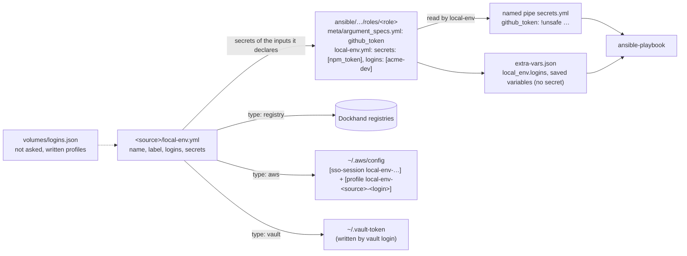
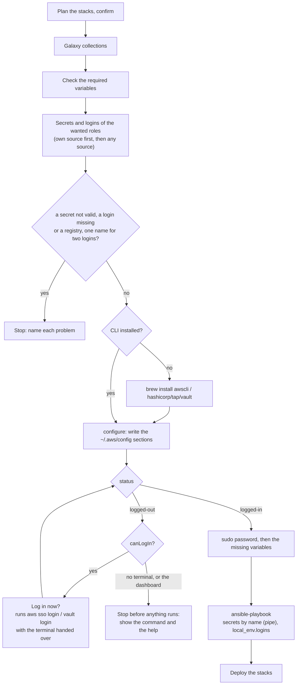
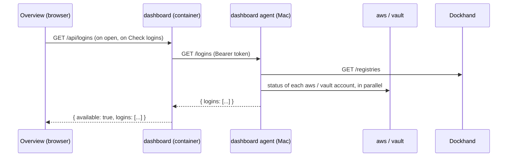

# Logins

Status: done. The logins live in the [source manifest](source-manifest.md).

## What it does

A **login** is an account that a source needs the user to be signed in to. A
source declares its logins once, in its **manifest**: `local-env.yml` at the
root of the source. local-env checks them, asks the user to log in when one is
missing, and shows their state.

There are three types of login:

| Type       | For                                      | The credential                                  |
| ---------- | ---------------------------------------- | ----------------------------------------------- |
| `registry` | Private images of the source's templates | A token that the user types. Dockhand keeps it. |
| `aws`      | AWS Secrets Manager, read by roles       | The AWS CLI's SSO session (`~/.aws/sso/cache`)  |
| `vault`    | HashiCorp Vault, read by roles           | The Vault CLI's token (`~/.vault-token`)        |

local-env never keeps an AWS or a Vault secret. Roles read their secrets with
the vendor's CLI, which uses the session. local-env makes sure that the CLI is
installed, configured and logged in **before** anything runs.

```yaml
# <source>/local-env.yml
name: acme-platform
label: Acme Platform
logins:
  ghcr:
    type: registry
    host: ghcr.io
    usernameHelp: your GitHub username
    tokenHelp: a classic token with read:packages
  acme-dev:
    type: aws
    region: eu-west-1
    sso:
      startUrl: https://acme.awsapps.com/start
      region: eu-west-1
      accountId: '123456789012'
      roleName: DevSecretsRead
    help: Request the dev account in #platform
  data-vault:
    type: vault
    address: https://vault.data.acme.io
    namespace: dev
    method: oidc
    role: developer
    help: Ask #data for the developer role
```

- `name` and `label` belong to the [source manifest](source-manifest.md).
  `logins` maps a login name to a login. A login name is lowercase letters,
  digits and `-`, unique in its source.
- The manifest also lists the source's **secrets**, by the name of the variable
  each one fills: the login, the secret (`ref`) and the key to take (`field`). A
  role of the source gets the ones it declares as inputs in
  `meta/argument_specs.yml` (or asks for in its `local-env.yml`:
  `secrets: [npm_token]`), and uses them as any variable:

  ```yaml
  # <source>/local-env.yml
  secrets:
    github_token: { login: acme-dev, ref: platform/dev/github, field: token }
  ```

  ```yaml
  # ansible/…/roles/github/meta/argument_specs.yml: github_token, no_log
  - name: Save the GitHub token
    ansible.builtin.command: gh auth login --with-token
    args:
      stdin: '{{ github_token }}'
    no_log: true
  ```

- `login: acme-dev` finds the login in the source first, then in any source.
  `acme-platform/acme-dev` names the source.
- A role that runs the CLI for more than a secret (`aws s3 sync`) names the
  login in `logins: [acme-dev]`, and its tasks use the login's environment, in
  the extra var `local_env.logins`:
  `environment: "{{ local_env.logins['acme-dev'].env }}"`.

- A registry login is not named by anything. The images of the templates need
  it.
- `local-env install` handles the logins of the wanted roles before the
  playbook: it installs the CLI, configures it, checks the session, and logs in.
- `local-env sources login [source] [--login <name>]` logs in to the logins of a
  source. `local-env sources logout [source] [--login <name>]` logs out. Without
  a source, both list the sources and the state of their logins. They show the
  AWS profile of each `aws` login, for the user's own `aws` commands.
- `local-env sources list` shows if each source with logins is logged in.
  `local-env doctor` checks every login.
- `start` and `sources sync` ask for the missing registry logins, as before.
  They do not ask for AWS or Vault logins: they read no secret.
- `local-env sources remove` removes the AWS profiles that only this source
  used.
- The Overview of the dashboard shows the logins of each source in its row of
  the **Sources** card (`features/logins/login-state/`): each account, its type
  and its state (logged in as …, logged out, CLI not installed, not asked). A
  login that waits for you is also in **Needs attention**, at the top of the
  page, with the command to copy
  (`local-env sources login acme --login acme-dev`) and the `help` of the source
  (`features/overview/attention.ts`). It checks them when the page opens, and
  again with **Check logins**.
- The dashboard never logs in and never takes a credential.

## How it works

### The files



- `services/dashboard/source-manifest.ts` reads the manifest
  ([Source manifest](source-manifest.md)). This feature uses its `logins` and
  its `secrets`. `services/dashboard/tools.ts` gives each role the names its
  source's vault gives it (`secrets` of the role: its inputs that the manifest
  names, and the names its `local-env.yml` asks for), and `role-graph.ts` marks
  those inputs `vault`: never asked, saved or passed by the user, shown "From
  the vault" in the Variables form.
- `apps/cli/src/logins/types.ts` defines a `LoginType`: `parse` (the YAML entry
  to a typed login, or an error that names the field), `identity` (the key that
  makes two declarations one account) and `title`. A `SessionLoginType` (aws,
  vault) adds what its CLI needs, as data: `cli` (the binary and its Homebrew
  formula), `env`, `configure` (writes the config that is no secret,
  idempotent), `statusCommand` and `describeSession`, `loginCommand`,
  `logoutCommand`, `help`, `facts` (what a role gets beside `env`) and
  `secretCommand` (the command that prints one secret, and the keys to take from
  its JSON output).
- `secrets.ts` reads the `secrets` of a manifest (`login`, `ref`, `field`) and
  checks the names. It is not tied to roles: Docker stacks will use the same
  secrets.
- `session.ts` runs them: `sessionStatus` (`logged-in`, `logged-out`, `no-cli`),
  `logInToSession` and `logOutOfSession` with the terminal handed over, and the
  line that the lists show. `canLogIn` is false without a terminal, and in a run
  of the dashboard agent, which sets `LOCAL_ENV_FROM_DASHBOARD=1`.
- `declared.ts` reads the logins of the manifests: by type (`readSourceLogins`,
  `listAccounts`, one entry for each account), or by name (`findSourceLogin`).
  `listing.ts` gives the lines of `sources list`, `sources login` and `logout`.
- `prepare.ts` serves whatever needs a login or a secret (a role, later a stack:
  a `Consumer`, its label and its source): `resolveSecret` finds a secret of the
  consumer's source with its login and command, `ensureSessions` installs the
  CLIs and checks or opens each session once, and `readSecrets` reads the
  values. `wanted.ts` adds what roles need: the names each one gets, the values
  that `vars:` give instead, and one name for one secret and one login in the
  whole run (`prepareLogins`, before the playbook). `index.ts` lists the types
  and checks the logins of a manifest (`checkManifestLogins`), for `sources add`
  and `doctor`.
- `registry.ts`, `aws.ts` and `vault.ts` implement the types. `ini.ts` edits the
  sections of `~/.aws/config`.
- `volumes/logins.json` in the home folder keeps the logins that the user does
  not want to be asked about again (by identity), and the AWS profiles and
  sso-sessions that local-env wrote.

The identity of each type:

| Type       | Identity                         | Two declarations with the same identity… |
| ---------- | -------------------------------- | ---------------------------------------- |
| `registry` | the host (`ghcr.io`)             | share one Dockhand login                 |
| `aws`      | the source name + the login name | are the same login                       |
| `vault`    | address + namespace              | share one token                          |

### The secrets

Before the playbook, once the sessions are ready, local-env reads the secrets
that the roles of the run get from their source, and gives the values to
Ansible.

- A role gets a secret of **its own source** only: the source that owns the role
  chose to give it. `wanted.ts` takes the names of the role's `secrets`, leaves
  out those that a role of the run passes to it (`vars:`, which win:
  `passedVars` in `role-graph.ts`), and finds each in the `secrets` of the
  role's source manifest (`secrets.ts` checks them). A name that the source does
  not declare, an entry that is not valid, or a login that is missing stops the
  install before anything runs.
- The login is found in the source first, then in any source, and its type gives
  the command that prints the secret (`secretCommand`):
  `aws secretsmanager get-secret-value --secret-id <ref> --query SecretString --output json`,
  which prints the text as a JSON string (null for a binary secret: an error;
  `--output text` would print `None`), or `vault kv get -field=<field> <ref>`,
  which prints the value as it is, with no newline after it.
- `session.ts` runs it with the login's environment (`readSecret`), and takes
  the field from the JSON output for AWS (`pickSecretValue`). The secrets are
  read in parallel, each once even if several roles need it. One that cannot be
  read stops the install before anything runs, with the error of the CLI.
- `apps/cli/src/core/secret-pipe.ts` gives the values to Ansible:
  `--extra-vars @<run folder>/secrets.yml`, a named pipe (`mkfifo`, mode 0600),
  each secret as the variable of its name. A `/bin/cat` writes into it: the
  kernel holds it until Ansible opens the pipe, and the values reach it on its
  stdin. Ansible reads the pipe once; nothing is on the disk. When Ansible is
  done, local-env stops the writer if it still waits.
- Each value is tagged `!unsafe` (`github_token: !unsafe "…"`): Ansible never
  templates it, so a secret can hold `{{`.
- A secret wins over a saved value of the same name: local-env leaves that one
  out of the extra vars file. `installed.json` records no secret.
- Ansible's variables are global: two sources that give `github_token` from two
  different secrets, to roles of one run, stop the install.

`local_env.logins`, in the extra vars file, holds the logins that the roles name
in `logins:`. There is no secret in it:

```yaml
local_env:
  logins:
    acme-dev:
      type: aws
      profile: local-env-acme-platform-acme-dev
      region: eu-west-1
      env:
        { AWS_PROFILE: local-env-acme-platform-acme-dev, AWS_REGION: eu-west-1 }
    data-vault:
      type: vault
      address: https://vault.data.acme.io
      namespace: dev
      env: { VAULT_ADDR: https://vault.data.acme.io, VAULT_NAMESPACE: dev }
```

- The key is the login as the role names it: `acme-dev`, or
  `acme-platform/acme-dev`. Ansible's extra vars are global: a key has one value
  for the whole run.
- If two roles name `acme-dev` and it finds a different login for each (two
  sources declare `acme-dev`), the install stops before anything runs. It names
  the roles and the sources. The roles must name the source:
  `acme-platform/acme-dev`.

### Before the install



- One account is checked once per run, even if ten roles need it. AWS profiles
  that share an sso-session need one login.
- The login runs with stdio inherited: the browser, an MFA prompt or a password
  goes between the user and the vendor's CLI. local-env does not read that
  output.
- When the user declines the login, the install stops before Ansible and names
  the roles that need it.
- The logins come after the check of the variables, so that a run that cannot
  start asks nothing, and before the sudo password, so that a login that fails
  wastes no typing.
- A missing CLI is installed without a question, like the Galaxy collections:
  the install needs it. If `brew` is missing too, the install stops.
- Each install removes the sections of `~/.aws/config` that local-env wrote for
  a login that no source declares any more. `sources remove` does it too.

### The state in the dashboard



- The container has no AWS or Vault session, and cannot read the sources' logins
  with the CLI's code. The agent runs that code on the Mac, as the user: it
  builds the whole list (`apps/cli/src/logins/report.ts`, `buildLoginsReport`),
  registries included. The dashboard server only passes it on
  (`services/dashboard/server.ts`, `/api/logins`).
- A row has the name, the type, the title, the sources, the state (`logged-in`,
  `logged-out`, `no-cli`, `not-asked`, `unknown` when Dockhand cannot be
  reached), a detail without a secret (as whom, or the CLI's error), the command
  to run and the help (`LoginRow` in `services/dashboard/agent-protocol.ts`).
- The page asks when it opens and on **Check logins**, never on a timer, and not
  on window focus: each check is a call to AWS, Vault or Dockhand
  (`apps/web/src/features/logins/logins.ts`). The states are not in
  `/api/events`, which sends every change at once. The agent keeps no cache: a
  refresh checks again.
- Without the agent, `/api/logins` answers `{ available: false }`: the Sources
  card says to start it, and Needs attention shows `local-env start`.

### The `aws` type

- `cli`: `aws` (`brew install awscli`).
- `configure`, when the login has `sso`: local-env writes two sections in
  `~/.aws/config` (or `$AWS_CONFIG_FILE`) and keeps the rest of the file:
  - `[sso-session local-env-<hash of start URL and SSO region>]`. All the logins
    of one Identity Center share it: one browser login covers all their accounts
    and roles.
  - `[profile local-env-<source>-<login>]`, for example
    `local-env-acme-platform-acme-dev`. The source name is unique and the same
    on every Mac, so the profile name is too.

  local-env records the sections in `volumes/logins.json`. It rewrites them on
  each install, and removes the ones that no login uses any more. It never
  changes a section that it did not write.

- Without `sso`, the login names the user's own profile (`profile: acme`):
  `credential_process`, aws-vault or keys. local-env writes nothing.
- `env`: `AWS_PROFILE` and `AWS_REGION`.
- `status`: `aws sts get-caller-identity --profile <profile>`. Exit 0 is logged
  in.
- `logIn`: `aws sso login --profile <profile>`. Without `sso`, local-env shows
  the `help` and the command that failed.
- `logOut`: `aws sso logout --profile <profile>`.

### The `vault` type

- `cli`: `vault` (`brew install hashicorp/tap/vault`).
- `configure`: nothing. The CLI has no config file for the address.
- `env`: `VAULT_ADDR`, and `VAULT_NAMESPACE` when the login has a `namespace`.
- `status`: `vault token lookup`, with the `env`. Exit 0 is logged in.
- `logIn`:
  `vault login -no-print -method=<method> [-path=<mount>] [role=<role>]`, with
  the `env`. `method` is `oidc` by default. `-no-print`: the CLI keeps the token
  without showing it in the terminal.
- `logOut`: `vault token revoke -self`, with the `env`. The token file stays,
  with a token that no longer works.

### The `registry` type

The code is in `apps/cli/src/logins/registry.ts`: it asks Dockhand if a login of
the host exists, asks for a username and a token, tests them with Dockhand and
saves them there. `registryLoginsStep` is the provisioning step of `start` and
`sources sync`. A registry login has no `env`: a role cannot name it.

- The identity is the full host: `ghcr.io/team-a` and `ghcr.io/team-b` are one
  login, as Docker keeps one login for each host.
- `sources login acme --login ghcr` (the name in the manifest) logs in to one
  login of the source. It replaced `--registry <host>`.
- "Don't ask again" is `registry:<host>` in `volumes/logins.json`.
- `sources add` refuses a manifest whose logins are not valid
  (`checkManifestLogins`): an unknown `type`, a missing `host`. A login that is
  not valid in a source pulled later is left out.

### Tests

`aws` and `vault` are faked binaries (`tests/support/fake-bin.ts`).
`tests/unit/core/secret-pipe.test.ts` checks the pipe, and the fake
`ansible-playbook` reads it like Ansible: the e2e tests check what it got, and
that no file of the run folder holds a value. A login that opens a session is a
rule with `touch: <file>`, and the status after it is a rule with
`ifFile: <file>`. `tests/e2e/commands/logins.test.ts` covers the install,
`sources login`, `logout`, `list`, `remove` and `doctor`. The `aws` type was
also checked by hand against MiniStack, with the real AWS CLI and Ansible: a
role read a secret with only
`environment: "{{ local_env.logins['acme-dev'].env }}"`, and the real Ansible
validated an input of `argument_specs.yml` (`no_log`, required) that the pipe
filled.

## Why

- **One manifest per source.** A source had `docker/registries.json`, and the
  secret managers needed a file too. A registry and a secret manager are the
  same thing for the user: an account to sign in to, declared by the source,
  checked, shared by the sources that use it. The manifest at the root serves
  the templates and the roles, and it has room for what a source says about
  itself (`label`). It is YAML, like the `local-env.yml` of a role.
- **Company vaults, not a store of local-env.** Companies keep their secrets in
  a vault already, with SSO, audit and rotation. A copy in local-env (or in the
  Keychain) is a second place to rotate and to protect.
- **The vendor's CLI owns the session.** The CLI handles SSO, MFA, profiles and
  `credential_process` as the company set them up. local-env holds no vault
  credential, and the compiled binary needs no SDK.
- **The source maps names to secrets, the role declares inputs.** The source
  knows the vault: its logins and where each secret is, once, like its logins.
  The role stays plain Ansible: an input of `argument_specs.yml`, a variable in
  its tasks, `-e github_token=…` without local-env. A Galaxy role that takes a
  token can be fed from the vault without a change: a role of the source asks
  for the name.
- **Only the role's own source.** A role of another team's source that declares
  `github_token` must not get your token: the source that owns a role decides
  what it gets. Logins can come from any source, since a company source can
  declare the accounts of every team, but the names stay per source.
- **local-env knows what to read before the run.** The inputs and the manifests
  say it: local-env makes the logins ready, checks every secret and reads only
  the ones that the tools of this install need. It cannot find them in the
  tasks.
- **One way for roles and stacks.** A secret is named after the variable it
  fills: an input of a role, a variable of a compose file. The same `secrets` of
  the manifest will serve the stacks, with one `secretCommand` per type.
- **local-env reads the secrets, not Ansible.** Ansible's lookups
  (`amazon.aws.secretsmanager_secret`, `community.hashi_vault`) need `boto3` and
  `hvac` in Ansible's Python. Homebrew's Ansible has neither, and a role cannot
  install them for the run it is in. local-env runs the vendor's CLI, which it
  installs, with the session it just checked. A lookup of our own would be
  Python to ship and test, for the same commands.
- **The same code for roles and stacks.** A Docker stack gets its secrets from
  local-env too, before the deploy: `readSecret` serves both, and a provider is
  written once, in TypeScript.
- **Everything before the run.** A secret that cannot be read (no access, a
  wrong field, a session that ended) stops the install before any role runs, not
  in the middle. Each secret is read once, not at each use.
- **Read at every install, never kept.** Each install runs all the wanted tools
  again, and reads their secrets again: a rotated secret is picked up at the
  next install, and local-env has no copy to protect or to refresh.
- **A named pipe, not a file.** The run folder is the user's alone, but a file
  would hold the values on the disk for the whole run, and in a backup taken
  then. The pipe holds nothing on the disk: Ansible reads the values from the
  kernel.
- **The variable of the input, not a variable of local-env.**
  `{{ github_token }}` is what a role author writes anyway, and what the role's
  spec checks. The Variables form shows that the vault gives it, as it shows the
  values a profile gives.
- **`logins:` stays, for the CLI itself.** A role that syncs a bucket or writes
  to a Vault needs the login's environment, not a secret. With
  `environment: "{{ local_env.logins[name].env }}"`, the task is the same for
  AWS and Vault.
- **local-env names the AWS profile.** The source does not know the profiles of
  the user or of the other sources. A name that a source picks can be the name
  of another account in another source: its roles then read the secrets of the
  wrong account. `local-env-<source>-<login>` cannot clash, because the source
  name is unique, and it is the same on every Mac. Two sources that declare the
  same account get two profiles, but one sso-session: one login.
- **One sso-session for each Identity Center.** The SSO token belongs to the
  session, not to the profile. Profiles that share it need one browser login.
- **A clash of login names stops the install.** Extra vars are global. Picking
  one of the two would give a role the account of another source. The role names
  the source to fix it.
- **Log in before the playbook, not in it.** Without a session, the CLI fails at
  once (`Token for acme does not exist`, exit 255), and `no_log` hides the
  message. A login task in a role would stop the run in the middle, after other
  roles ran, and open a browser from the dashboard. Before the playbook, the
  user answers everything at the start and the run goes on alone.
- **local-env installs and configures the CLI.** Else, the first install cannot
  check a session: the role that installs the CLI and writes the profile runs in
  the playbook, after the check.
- **local-env writes `~/.aws/config` itself.** `aws configure set` cannot write
  an `[sso-session]` section: it writes the keys into `[default]`. The
  `sso-session` format refreshes the token without a new login, the old profile
  keys do not.
- **The dashboard never logs in.** It runs in a container. A login opens a
  browser or asks for a password: it belongs to a terminal on the Mac.
- **In the Sources card, not a card or a page of their own.** Logins belong to
  sources: each one shows under the source that needs it. What to do about one
  is in Needs attention, with the other problems of the page, so that the top of
  the Overview answers "is everything OK?".
- **The agent builds the list, not the container.** Mounting `~/.aws` and
  `~/.vault-token` into the dashboard gives a container the user's sessions. The
  agent already runs on the Mac as the user, behind a token, with the CLI's
  code: the dashboard needs no copy of it.
- **On open and on Check logins, no polling.** A login changes when the user
  logs in in a terminal: they come back and refresh. A timer would call AWS and
  Vault every minute for nothing.

## Limits

- Only `registry`, `aws` and `vault`. A new type is a new file in
  `apps/cli/src/logins/` and a line in its list.
- Templates cannot use a secret of a vault yet (`${NAME}` filled from AWS or
  Vault): the `secrets` of the manifest are ready for it. Only roles read
  secrets. A registry token cannot come from a vault yet.
- A role that uses `local_env.logins` runs only with local-env, unless it gives
  a default (`| default({'AWS_PROFILE': 'acme'})`). A role that takes a secret
  as an input runs without local-env with `-e`.
- A secret is text: an input of another type gets text, which Ansible converts
  and checks.
- local-env reads a secret of a role of the run even when the role skips the
  task that uses it (`when:`, tags): it cannot know which tasks will run.
- A binary secret (AWS `SecretBinary`) stops the install: local-env reads text
  only.
- If the CLI is killed with `kill -9` before Ansible reads the pipe, its writer
  (`/bin/cat`) stays, waiting, with the values in its stdin, until the Mac
  restarts. A Ctrl-C or a `kill` stops it.
- The values are in the memory of Ansible for the whole run. A task without
  `no_log` can print one.
- Two roles of one install that name the same login without its source must find
  the same login.
- The Vault CLI keeps one token, in `~/.vault-token`. Two Vault servers log each
  other out: the status of the other one is `logged-out`, and the next install
  logs in again. A token helper by address would fix it.
- The `vault` type supports static reads only. Dynamic secrets (leases) are not
  renewed.
- local-env checks the session at the start of the install. A session that ends
  during the run makes the role fail; the next install logs in again.
- A renamed login or source gives a new profile name. The user's own
  `aws --profile` commands must use the new name.
- On the first install from the dashboard, the CLI installs, but the login stops
  the run: the user logs in in a terminal, then installs again.
- The dashboard shows the logins only when the dashboard agent runs, the
  registries too.
- The install dialog does not list the logins that the next install needs: the
  install says it, and stops before anything runs.
