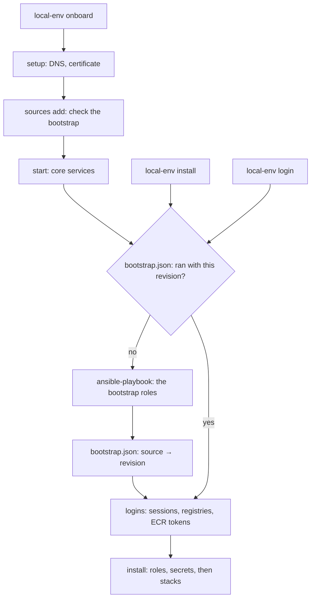

# Source bootstrap

## What it does

A source can list roles in the `bootstrap` of its manifest. These roles make the
Mac ready for the logins of the source: they install a CLI, write an AWS
profile, set up a VPN client. local-env runs them before the logins.

```yaml
# local-env.yml
name: acme
bootstrap:
  - acme.platform.aws_access
  - acme.platform.vpn_client
logins:
  acme-dev:
    type: aws
    profile: acme-dev # written by acme.platform.aws_access
```

The work has three phases, in this order:

1. **Bootstrap**: the roles of `bootstrap`. No secrets, no logins, no stacks.
2. **Logins**: the sessions, the registry logins and the ECR tokens.
3. **Install**: the profile and the picked tools, then their stacks. Secrets are
   allowed.

The bootstrap runs when it never ran, or when its roles changed:

| Command                                | What it does with the bootstrap                             |
| -------------------------------------- | ----------------------------------------------------------- |
| `local-env sources add`                | Asks: "acme has a bootstrap (…). Run it now?"               |
| `local-env install`                    | Runs it first, without a question                           |
| `local-env login`                      | Runs it first, without a question                           |
| `local-env onboard`                    | Runs it after `start`, then the logins, then the install    |
| `local-env sources sync`, `update`     | Asks when its roles changed since it ran (`--yes` runs it)  |
| `local-env sources bootstrap [source]` | Runs it, even when it is done                               |
| `local-env start`                      | Never runs it: an ECR token that needs it only warns        |
| `local-env doctor`                     | Fails when it can't run, warns when it never ran or changed |

## How it works



- `services/dashboard/bootstrap.ts`, shared by the CLI and the dashboard, only
  reads. It finds each role that `bootstrap` names (in the source first, then in
  any source, as Ansible finds a dependency), walks their dependencies
  (`role-graph.ts`), and checks each role of the run. It makes the revision: a
  hash of the id and the revision of each role of the run (each revision is a
  hash of the role's folder), and of the values that their inputs get from
  `variables.json` (never a secret). `apps/cli/src/core/bootstrap-plan.ts` gives
  it the sources and the values of the CLI.
- `apps/cli/src/core/bootstrap.ts` runs the bootstraps through `runPlaybook` of
  `tools.ts`: the same run folder, collection links, Galaxy collections, inputs,
  sudo password on stdin and clack output as an install. All the pending
  bootstraps go in one playbook, so the password is asked once.
- `volumes/tools/bootstrap.json` keeps, by source, the revision that ran and
  when. It is written only when the playbook succeeds: a bootstrap that failed
  runs again next time. The revision is made again after the run, with the
  values the run asked for and saved.
- The bootstrap roles go in `installed.json` like the tools. They are roots,
  like the profile and the picks: `forgetUnwanted` keeps them, and
  `currentRoots` gives their inputs to `local-env vars`.
- The dashboard's `tools` topic gives the bootstraps of the sources, with their
  state (`done`, `never`, `changed`, `blocked`). The Tools page leaves out the
  roles they list, and counts the roles those include as wanted, so one that a
  bootstrap installed is not "unpicked". The Variables sheet shows their inputs.
  The Overview shows each bootstrap in the panel of its source
  (`features/bootstrap/`), and one that waits for you in Needs attention, with
  its command.
- `sources add` checks the bootstrap after the clone (`checkSource` of
  `addSource`), and removes the source when it can't run.
- `install` refreshes the ECR tokens again after the playbook, before the stacks
  deploy (`registryTokensStep`). A role may have just written the AWS profile
  that the tokens come from.

## Why

- **A bootstrap gets no secret.** This is the rule that makes the order work. A
  secret needs a login, and the login may need what the bootstrap sets up (the
  AWS profile, the CLI). If a bootstrap role could read a secret, the install
  would stop before the role that makes the login possible. The same holds for
  logins (`logins:` in a role's `local-env.yml`) and stacks (a stack can read
  secrets and pull private images). The check covers the dependencies too: a
  dependency runs in the same playbook.
- **The source lists its bootstrap.** We thought of a split that the install
  makes alone: the roles without secrets first. It does not work. `login` and
  `start` run no playbook. The role that writes the profile may not be in the
  user's profile at all. The source knows what its logins need, so the source
  says it.
- **"bootstrap", not "setup".** `local-env setup` sets up the Mac for local-env
  (DNS, certificate). The same word for two steps of the same onboarding would
  confuse the users.
- **A hash, as for tools.** A changed role runs again, as `installed.json` shows
  a changed tool. The hash covers the folders of the roles of the run, not the
  whole source: a change to a template must not run a sudo playbook. It covers
  the values of their inputs too: a user who fixes their AWS role gets a new
  profile at the next install.
- **Not in the Tools catalog.** The catalog is for picking, and a bootstrap is
  not a choice: the source needs it. A row with a switch that does nothing would
  confuse the users. The Overview shows it with its source, as the logins, which
  it serves.
- **`install` and `login` run it without a question.** They can't work without
  it. `sources add` asks, as the user did not ask for a playbook. `sync` and
  `update` ask only for a changed bootstrap: a user who declined at
  `sources add` is not asked on every update.
- **Never from `start`.** `start` brings the services back after a reboot. It
  must stay fast and ask nothing. An ECR token that fails only warns there.
- **From the dashboard too.** A bootstrap names no login, so it never opens a
  browser. The dashboard agent runs `install` in a pty, where the sudo password
  can be typed.

## Limits

- A bootstrap role can't read a secret, even one that a login of another source
  could give.
- `local-env` doesn't uninstall: a role removed from `bootstrap` stays on the
  Mac.
- `start` in `onboard` runs before the bootstrap: an ECR token of the source
  warns there, then the logins step gets it.
- The aws login's `roleName` stays one role for every user (a role list tried in
  order is parked). A bootstrap role that writes the profile with each user's
  role works around it.
