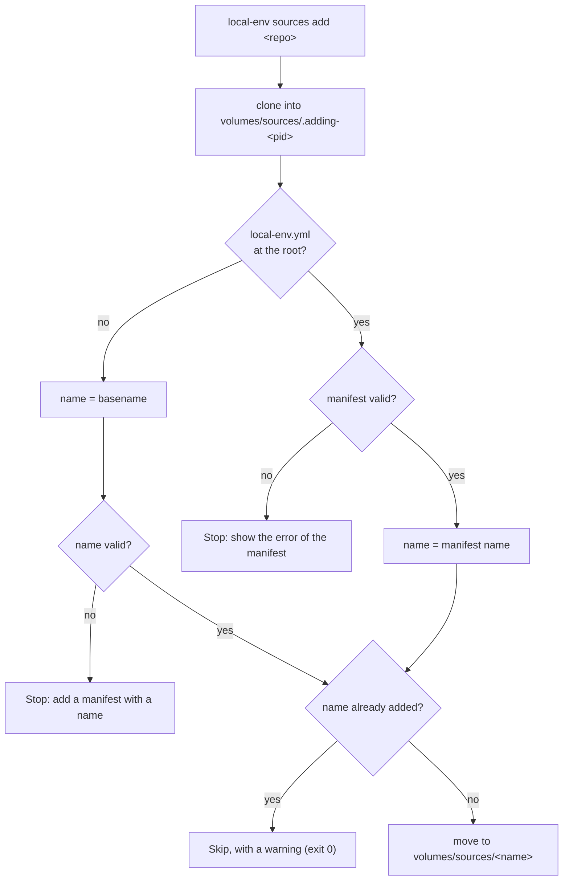

# Source manifest

Status: done for `name` and `label`. [Logins](logins.md) reads `logins`.

## What it does

A source can have a **manifest**: `local-env.yml` at the root of its repo. It
says what the source is, for every machine that adds it.

```yaml
# <source>/local-env.yml
name: acme-platform # unique: the name of the source on every Mac
label: Acme Platform # free text: what the dashboard and the CLI show
logins: # see Logins
  ghcr:
    type: registry
    host: ghcr.io
```

- `name` is required in a manifest. It is lowercase letters, digits and `-`,
  like the name of a source today.
- `label` is optional, free text. Without it, local-env shows the `name`.
- `logins` is optional. [Logins](logins.md) explains it.
- `local-env sources add <repo>` reads the manifest of the repo before it clones
  it into `volumes/sources/<name>`. With a manifest, the folder is the `name` of
  the manifest.
- When a source of that `name` is already added, `sources add` skips the repo
  with a warning and exits 0: the same repo again, or another one with the same
  name.
- The dashboard's Sources card, `sources list` and the prompts show the `label`.
  Commands take the `name`: `local-env sources login acme-platform`.
- A repo without a manifest still works. Its name is the repo's basename. It has
  no label and no logins. If that name is not valid, the author adds a manifest.
- References to another source use its name: a role's
  `stacks: [acme-platform/postgres]`, a role's
  `logins: [acme-platform/acme-dev]`.

## How it works

- `schemas/source-manifest.json` is the JSON schema of the manifest, served from
  GitHub (`raw.githubusercontent.com/cgaube/local-env/main/…`). A manifest names
  it on its first line (`# yaml-language-server: $schema=…`) or in a `$schema:`
  key, which local-env ignores. The schema is stricter than the CLI: it marks
  fields that it does not know, which the CLI ignores.
  `apps/cli/tests/unit/logins/manifest-schema.test.ts` checks that it has the
  name rules and the login types of the CLI: a new type of login adds its
  definition there.



- `services/dashboard/source-manifest.ts` reads and checks the manifest:
  `readSourceManifest(dir)` gives `{ name, label, logins }`, `null` without a
  file, or throws a `SourceManifestError` that names the field.
  `tryReadSourceManifest` gives `null` for a manifest that is not valid: for
  what only shows it. It imports nothing of the CLI, so the dashboard
  (`server.ts`, the `label` of each source) and the CLI share it.
- `addSource` (`apps/cli/src/sources/sources.ts`) clones into
  `volumes/sources/.adding-<pid>`. `listSources` and the dashboard skip it: the
  name of a source cannot start with a dot. It renames the folder when the name
  is known, and removes it on any error.
- `sources list` and the select of `sources remove` show
  `Acme Platform (acme-platform)` (`describeSource`).
- `sources sync` pulls the sources, then reads their manifests again. If the
  `name` of a manifest is not the name of its folder, it warns and tells the
  user to remove the source and add it again. The source still works under its
  old name until then.

## Why

- **A name from the author, not from the user.** A source's name was the name
  that the user gave it. Two people could add one repo as `acme` and as
  `acme-templates`. References between sources (`shared/postgres`) and the
  support of a team need the same name on every Mac.
- **No `--name`.** A name that the user picks differs from Mac to Mac: that is
  what the manifest fixes. Sources are repos that a team writes for local-env
  (other Portainer catalogs go into Dockhand), so the author can always add a
  manifest.
- **A taken name skips the repo, it does not fail.** One rule covers the same
  repo added twice and two repos that claim one name. A setup script that adds
  its sources again stays green. The name is the identity: the first source
  keeps it.
- **A label beside the name.** The name is an id: short, lowercase, typed in
  commands. The label is for people: `Acme Platform`.
- **One file at the root, for the source.** The logins (registries) are about
  the whole source, not about `docker/` or `ansible/`. The manifest is YAML and
  has the same file name as the manifest of a role (`local-env.yml`): the root
  one is the source's, the one beside `meta/` is the role's.
- **Optional.** A repo of plain Portainer templates from elsewhere must still
  work without a file of local-env.

## Limits

- local-env does not rename a source when the `name` of its manifest changes.
  The user removes the source and adds it again.
- Two repos with the same `name` cannot both be added: the second one is
  skipped. The authors must agree on names.
