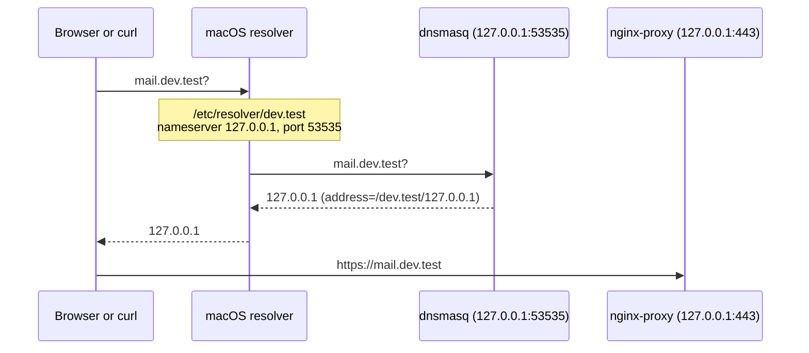
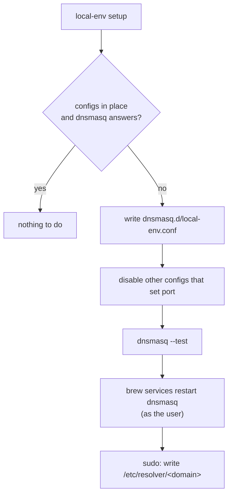

# Wildcard DNS

## What it does

Every name of the domain (`dev.test` by default) points to the Mac:
`https://mail.dev.test` reaches the proxy on `127.0.0.1`, which routes it to the
`mail` container. Other names are not touched.

- `local-env setup` sets it up, and `local-env config set domain` moves it to a
  new domain. Both ask for the password only to write `/etc/resolver/<domain>`.
- `local-env doctor` checks the dnsmasq config, that dnsmasq answers, and that
  macOS resolves a name of the domain.
- `local-env reset` removes it.

## How it works

- `apps/cli/src/core/dns.ts` writes the two files and restarts dnsmasq:
  `ensureWildcardDns` for `setup`, `removeWildcardDns` for `reset`.
- `apps/cli/src/utils/dnsmasq.ts` has the port (53535), the paths in Homebrew's
  folder, and the check for other configs that set `port`: dnsmasq does not
  start when two files set it.
- dnsmasq is a Homebrew service of the user (`brew services`, no sudo):
  `~/Library/LaunchAgents/sh.brew.dnsmasq.plist`, started at login.
- Containers do not use dnsmasq. They reach the routed hosts through the
  `local-env-hosts` network, where `proxy-connector` gives nginx every host as
  an alias.

## Why

- **`/etc/resolver` and not `/etc/hosts`.** A file in `/etc/resolver` sends a
  whole domain to one DNS server. `/etc/hosts` has no wildcards: each new app
  would need a new line and the password.
- **Port 53535 and not 53.** The resolver file gives the port, so dnsmasq does
  not need the DNS port. Port 53 needs root, and it can clash with other DNS
  tools on the Mac.
- **dnsmasq runs as the user, not as root.** A high port needs no root. A root
  service (`sudo brew services`) makes some of dnsmasq's files in Homebrew's
  folder belong to root: then `brew uninstall local-env`, which removes dnsmasq
  with it, fails with "Could not remove dnsmasq keg". It also needed the
  password at each restart. Homebrew warns that dnsmasq "must be run as root to
  start at system startup": a user service starts at login instead, before
  anyone uses local-env. `setup` hides that warning and shows Homebrew's output
  only when the restart fails.
- **dnsmasq and not a resolver of our own.** dnsmasq is small, well known and in
  Homebrew. It answers one rule (`address=/<domain>/127.0.0.1`) and needs no
  code from us.

## Limits

- macOS only. On other systems, `setup` says so and does nothing.
- One account per Mac: a second account would start a second dnsmasq on the same
  port, which fails. Homebrew has the same limit.
- `dig` asks a DNS server directly and does not read `/etc/resolver`: test with
  `dscacheutil -q host -a name <host>` or `ping`.
