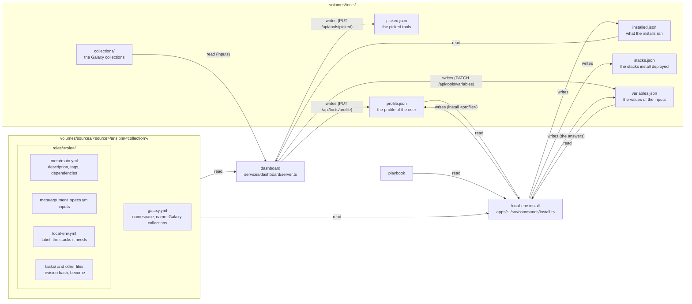
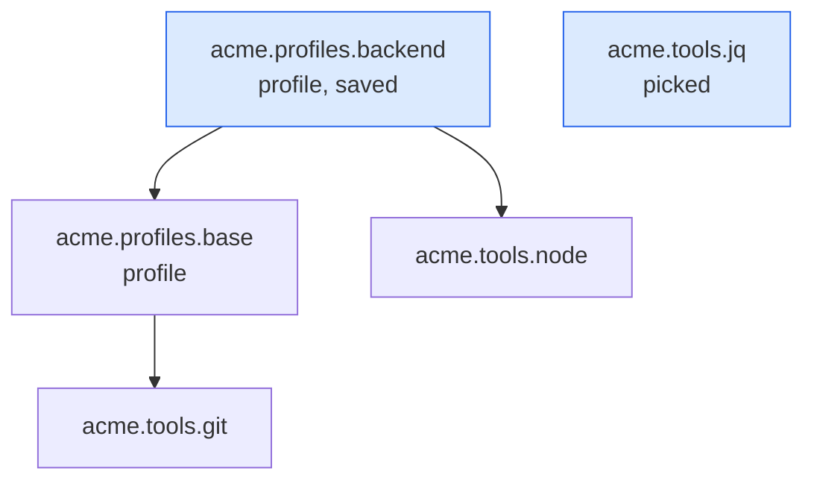
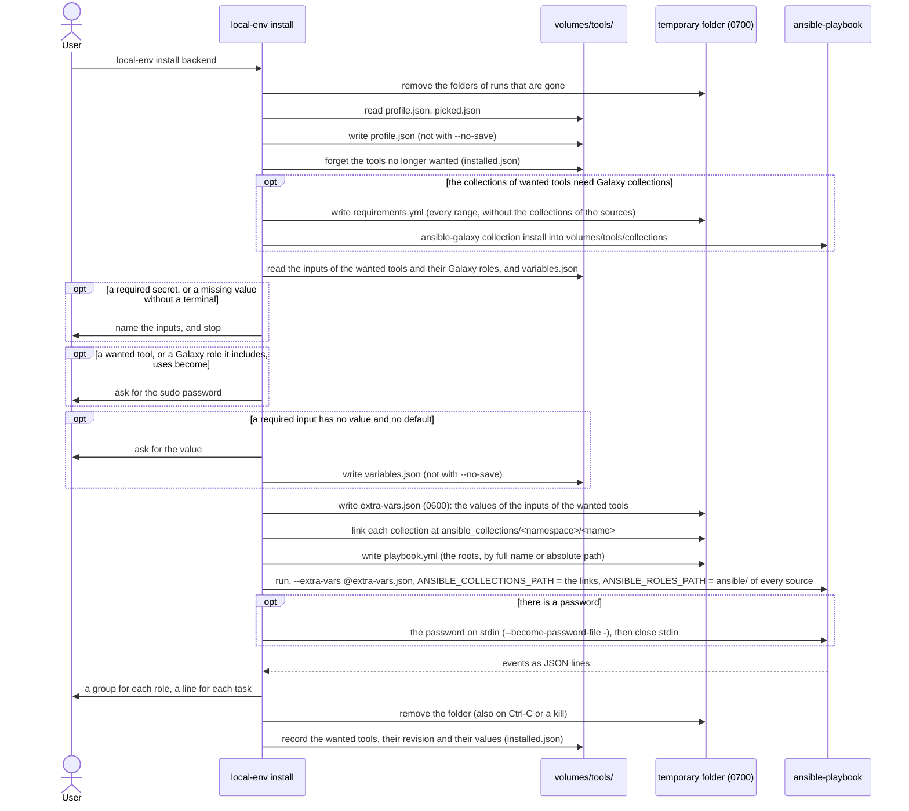
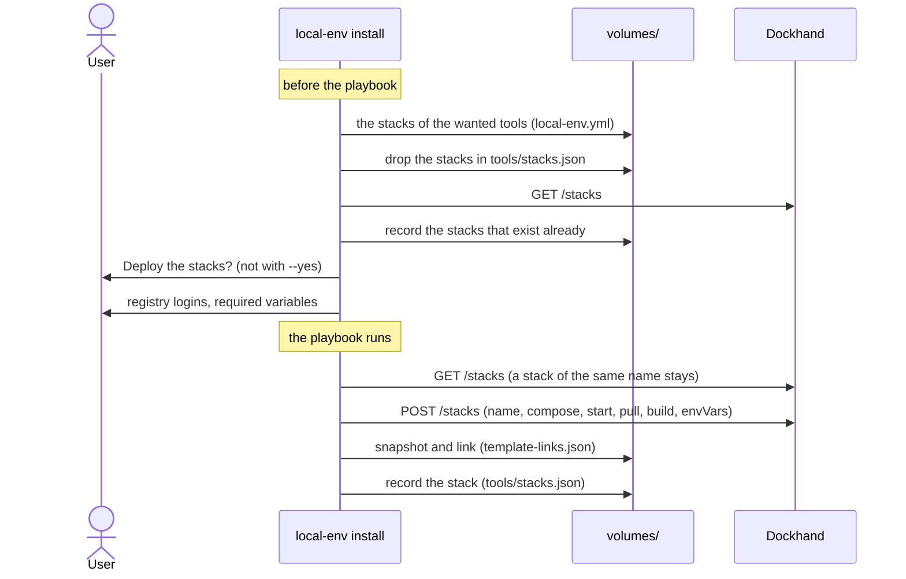

# Tools and profiles

Status: done. Tools, profiles, the Profiles page of the dashboard, the stacks
that tools need and the variables that tools need.

## What it does

A **tool** is an Ansible role in a source. The roles are grouped in Ansible
collections: `ansible/<collection>/galaxy.yml` gives the namespace and the name
of the collection, and its roles are in `ansible/<collection>/roles/<role>/`.
The full name of a role is `<namespace>.<collection>.<role>`. A folder of
`ansible/` without `galaxy.yml` is a plain role, named by its folder. A
**profile** is a tool that is a set of other tools. The user installs tools and
profiles on the Mac with `local-env install`.

- The Tools page of the dashboard lists the tools of every source. The user
  picks tools there with a switch. Picking a tool does not install it.
- The Tools and Profiles pages have an **Install** button
  (`features/tools/install-button/`). When the next `local-env install` has
  something to do, the button is primary, with the count: the tools to install
  or update, and the unpicked tools that it forgets. The Tools item of the
  sidebar shows the same count, on every page. The button then opens a dialog:
  the tools by profile and by pick, the unpicked ones, the command to copy, and
  the tools that use sudo (`features/tools/install-dialog/`). When the dashboard
  agent runs, the dialog's **Install** runs `local-env install` on the Mac and
  shows it in a terminal ([Dashboard terminal](dashboard-terminal.md)). With
  nothing to do, the button runs the install at once.
- `local-env install` installs the picked tools and the profile of the user. If
  the user has no profile and picked no tools, it asks for a profile in a
  terminal, with a select. It saves the profile (not with `--no-save`) and
  installs it. "No profile", or no terminal, shows the command and the URL of
  the Tools page.
- `local-env install <profile>` saves this profile as the profile of the user,
  then installs it. Later, `local-env install` installs it again with the picked
  tools. If the user has another profile saved, the CLI asks first ("Switch your
  profile from Backend to Frontend?"). Answering no changes nothing and installs
  nothing. Without a terminal, the CLI does not switch, unless `--yes`.
- `local-env install <profile> --no-save` installs the profile one time. The
  saved profile does not change.
- The user names a profile by its short name (`backend`) or its full name
  (`acme.profiles.backend`). If several profiles have this short name, the CLI
  asks for the full name. Only plain roles of the same name in two sources share
  a full name: the user writes `<source>/<name>`. The label is not a name to
  type: it can be a sentence. The CLI shows the name to type beside the label.
- The dashboard and the CLI show the `label` of the role's `local-env.yml`, or
  else the folder name of the role, title-cased: `git_extras` shows as
  `Git Extras`. A brand name (`TablePlus`) needs a label.
- local-env never uninstalls. When a tool is no longer wanted, it stays on the
  Mac. local-env removes it from the list of installed tools and shows a message
  ("No longer wanted, still on this Mac").
- The Profiles page of the dashboard (`/profiles`) lists every profile, with a
  search, a source filter and pages for hundreds of them. A card at the top
  shows the current profile: its tools to install and its stacks to deploy. A
  side panel shows all that a profile brings before the user picks it. The "Use"
  button saves the profile.
- The very bottom of the sidebar shows the current profile, or "No profile",
  under the version (`features/layout/nav-profile/`), where sidebar-07 puts who
  you are. It opens the Profiles page. If the sources have no profile, it is not
  there.
- On the Tools page, the roles of the profile show a locked switch ("In the
  backend profile"). The profiles are not rows of the Tools page.
- A role can need Docker stacks (`local-env.yml`). `local-env install` deploys
  the stacks that are missing, after one confirmation (`--yes` does not ask). It
  deploys each stack one time. If the user removes the stack, it stays removed.
- A role can need values from the user: its **variables**, declared in
  `meta/argument_specs.yml`, the format of Ansible. The code calls each declared
  variable an input. The Tools and Profiles pages have a **Variables** button
  beside **Install** (`features/tools/tool-actions/`). It opens one sheet with
  the variables of all that the next install runs: the profile, the picks, what
  they include, and Galaxy roles (`features/tools/variables-sheet/`).
- `local-env vars` lists the variables of your tools and their state, then the
  saved values that they no longer use. `local-env vars set <name> <value>`
  saves a value, or asks for it without a value (a select for choices, a yes/no
  for a bool, text else; without a name, it asks which variables, several at
  once, then saves them together), and `local-env vars unset <name>` removes it
  (`apps/cli/src/commands/vars.ts`). `local-env variables` is the same command.
- A variable is one field, because Ansible's variables are global. The fields
  are in panels that fold, one for each role, under the first role that declares
  the variable (`features/tools/role-input-panel/`). The profile's panel is
  always first. It holds all the values of the profile: the inputs it declares,
  and the values it sets for its tools. A field says which other roles use it,
  and when two roles declare it differently. A panel header counts the inputs
  and the missing values. The first panel is open, and also each panel with a
  missing value or a value that is not valid.
- The sheet has two tabs. **Your tools** holds the inputs of the next install.
  **Saved** holds the saved values that none of them takes, in panels by the
  role of the catalog that declares them, the profiles first, with a button to
  remove each.
- A value that a role which runs sets for another (the profile, in the `vars:`
  of its dependency) wins: its owner chose it. Its field is disabled, with that
  value and "Set by …".
- Picking a tool does not need its values. When a required input has no value,
  the Variables button says how many are missing. The install dialog names them
  and opens the sheet. The Install button counts only the changes. The dashboard
  does not start an install until the values are set: its Install buttons are
  disabled. `local-env install` asks in the terminal for a required input
  without a value and without a default. It gives the values to Ansible as extra
  vars.
- The values stay in `variables.json` when the user unpicks a tool, changes the
  profile, or when the role leaves the sources.
- `local-env install --dry-run` shows what the install runs and the state of
  each input. It runs, asks and writes nothing.

A profile is a plain Ansible role. The tag `profile` in `galaxy_tags` marks it.
Its dependencies are the tools and profiles that it contains:

```yaml
# ansible/profiles/roles/backend/meta/main.yml
galaxy_info:
  description: Backend developer setup
  galaxy_tags: [profile]
dependencies:
  - acme.profiles.base # another profile
  - acme.runtimes.node
```

## How it works

### The files



`services/dashboard/tools.ts` reads and writes these files. The dashboard and
the CLI both use it, so they read the files the same way. The id of a role is
`<source>/<full name>`. `picked.json` holds the ids of the picks. A pick whose
role is no longer in a source stays there, so the user can unpick it.

### What `local-env install` runs

The **roots** are the profile and the picked tools. The **wanted** tools are the
roots and all the tools that they include, at all depths. A dependency is found
by its name, in all the sources, as Ansible finds it: by its full name, or by
its short name in the collection of the role that names it.



In this example, the roots are `backend` and `jq`. The wanted tools are
`backend`, `base`, `git`, `node` and `jq`. The playbook names only the roots.
Ansible runs the dependencies itself.

`services/dashboard/role-graph.ts` finds the wanted tools (`includedRoles`,
`wantedRoles`). The module imports nothing, so the browser can load it too. The
dashboard and the CLI use the same code.

### One install



- `apps/cli/src/core/tools.ts` finds the profile, forgets the tools and runs the
  playbook.
- Ansible finds a collection only in an `ansible_collections/<namespace>/<name>`
  folder. The CLI links each collection of the sources there, in the temporary
  folder. `ANSIBLE_COLLECTIONS_PATH` is this folder, then
  `volumes/tools/collections`, and nothing else: not `~/.ansible/collections`
  and not the user's own `ANSIBLE_COLLECTIONS_PATH`. Ansible still adds the
  collections of the `ansible` package.
- A collection lists the Galaxy collections that it needs in the `dependencies`
  of its `galaxy.yml`. Before the password and the playbook, the CLI installs
  those of the collections of the wanted tools, with
  `ansible-galaxy collection install -r requirements.yml`
  (`apps/cli/src/core/galaxy-collections.ts`). One file holds every range, so
  that the resolver finds a version that meets them all. The collections of the
  sources are left out. `ANSIBLE_COLLECTIONS_PATH` is only
  `volumes/tools/collections`, so `ansible-galaxy` installs there. It skips a
  collection that is there already, or in the `ansible` package. If the install
  fails, the CLI stops before the playbook and names each collection and the
  `galaxy.yml` that asks for it.
- The CLI then reads the installed Galaxy roles that the wanted tools include,
  and their dependencies, for `become`.
- The playbook names a role of a collection by its full name, so that Ansible
  runs it in its collection. It names a plain role by its absolute path.
- `apps/cli/src/core/playbook-output.ts` shows the events of Ansible with clack.
  `install --verbose` shows the output of Ansible itself.
- A task with a loop shows the count of its items, then a line for each item, as
  the output of Ansible does: its label (`loop_control.label`, else the item),
  its state and its short message. A failed item shows its error. The callback
  sends no event for each item, only their results with the result of the task,
  so the lines come when the task ends. A failed item has an `exception`
  (ansible-core 2.19 and later) or `failed: true`.
- A task with `become: true` (or `yes`) in a wanted tool makes the CLI ask for
  the password. The CLI runs `ansible-playbook --become-password-file -` and
  writes the password to its stdin, then closes stdin. Without a password, the
  CLI gives no flag and closes stdin at once. Ansible then runs sudo with `-n`:
  a task that needs the password fails at once and does not wait. The CLI names
  its role and asks the user to report it.
- With `--verbose`, the output of Ansible goes to the terminal, but stdin is
  still the pipe of the password.
- `apps/cli/src/core/run-folder.ts` makes the temporary folder
  (`$TMPDIR/local-env-install-*`). The folder holds a `pid` file. On SIGINT,
  SIGTERM or SIGHUP, the CLI stops Ansible, removes the folder and exits (130,
  143 or 129). At the start of each run, the CLI removes the folders whose
  process is gone.
- If a picked tool is no longer in a source, the CLI unpicks it. If the saved
  profile is no longer in a source, the CLI clears it.

### The variables that tools need

```mermaid
flowchart LR
  specs["meta/argument_specs.yml<br/>of each wanted role,<br/>and of its Galaxy roles"]
  graph["wantedInputs<br/>role-graph.ts"]
  form["Variables sheet<br/>one form for the next install"]
  vars["local-env vars set / unset"]
  variables["volumes/tools/variables.json<br/>a value per name"]
  cli["local-env install"]
  extra["extra-vars.json (0600)<br/>in the run folder"]
  ansible["ansible-playbook<br/>--extra-vars @extra-vars.json"]

  specs --> graph
  graph --> form
  graph --> cli
  form -- "PATCH /api/tools/variables" --> variables
  vars -- writes --> variables
  variables --> cli
  cli -- "asks for a missing value, saves it" --> variables
  cli -- "only the inputs of the wanted roles" --> extra
  extra --> ansible
```

- `services/dashboard/tools.ts` reads the options of the entry point `main` of
  `meta/argument_specs.yml` (else of `argument_specs` in `meta/main.yml`): the
  name, `type`, `required`, `default`, `choices`, `description` and `no_log`. A
  missing or invalid file gives no inputs, and the role still installs. The file
  is one of the files of the revision hash.
- `listGalaxyRoles` reads the inputs and the dependencies of the roles in
  `volumes/tools/collections/`. The dashboard mounts `volumes/tools/`, so it
  reads them too. A Galaxy role counts only after its first install.
- `wantedInputs` (`services/dashboard/role-graph.ts`) lists the inputs of the
  wanted roles and of the Galaxy roles that they include. It merges an input
  that two roles declare: the first declaration gives the type, the choices and
  the description. The input is required if one declaration requires it, and
  secret if one declaration is secret.
- An input is required when `required: true` and there is no default. A default
  is the `default` of the spec, or the value of the variable in the role's
  `defaults/main.yml`: Ansible accepts both for a required option. Ansible does
  not apply the `default` of a spec, so local-env does not give it either. The
  role's `defaults/main.yml` gives it.
- A role can pass a variable to a dependency: `vars:` in the entry of
  `dependencies` in `meta/main.yml`, or a role parameter (an other key of the
  entry). `tools.ts` reads the names and the values as written
  (`dependencyVars`). An input is **provided** when a role that runs passes it
  to the declaring role. local-env looks at the roots that the playbook names
  (`playbookRoots`): a pick that the profile includes runs inside the profile. A
  provided input is not required and not passed: extra vars win over `vars:`, so
  a saved value would replace the value of the parent role. The sheet shows it
  disabled, with that value and "Set by …". A template (`"{{ … }}"`), or a value
  that does not fit the control, shows as written in a disabled text field.
- `toolInputs` (`features/tools/tools.ts`) gives the inputs of the next install,
  the missing ones, the required secrets and the unused saved values.
  `wantedInputs` flags an input that two roles declare with another type or
  other choices (`conflict`).
- The sheet shows a select for `choices`, a switch for a `bool`, a number field
  for an `int` or a `float`, and a text field for the other types. The default
  is the placeholder. A select or a switch saves at once. The text of a text
  field is a draft: it saves when the field loses the focus, on Enter, or when
  the sheet closes. An empty text field removes the value. A missing required
  value shows as an error.
- The sheet has one button, **Save**. Save and Escape save all the drafts, then
  close the sheet. A click outside the sheet does nothing. If a draft is not
  valid (not a whole number, not a JSON object), the sheet stays open and the
  field says why.
- `PATCH /api/tools/variables` takes only the names that change: a value, or
  `null` to remove it. The server merges them into the file as it is on the
  disk. It refuses a name that no role declares, a value of the wrong type, and
  a secret. A value that the file holds already, unchanged, stays: its role can
  have left the sources.
- `install` asks with `askSelect` for `choices`, `askConfirm` for a `bool` and
  `askText` for the rest. `parseInputText` turns the text into a value of the
  type: a number, a list from `a, b`, or a dict from a JSON object. The sheet
  uses the same function.
- After the answers, `install` says which values it saved, and that
  `local-env vars set` or the Variables sheet changes them, with the URL of the
  Tools page. With `--no-save`, it says that it used them for this run only.
- An install records in `installed.json` the values that each role got
  (`values`, of `passedValues`). When a value changes, the role shows as
  **Update available**, and the Install button counts it.

### The stacks that tools need



- `apps/cli/src/providers/docker/required-stacks.ts` plans the stacks before the
  playbook and deploys them after it. The user answers all the questions first,
  then the install runs without the user.
- The compose file is the same as the file that `catalog-server` gives to
  Dockhand: `build:` points to the build server and `${HOST_HOME}` is the home
  folder. The name of the stack is the compose `name:`, else the folder.
- The CLI links the stack to its template (`how: 'name'`) and saves the version
  as the base of the three-way merge. `update` and `sources sync` then update
  the stack like a stack from the Templates page of Dockhand.
- A variable in the form `${NAME:?help}` or `${NAME?help}` is required. The CLI
  asks for it. A name with `TOKEN`, `SECRET`, `PASSWORD`, `PASSWD` or `KEY` is
  masked and goes to Dockhand as a secret (`isSecret`).
- If Dockhand does not answer, the CLI installs the tools and only shows a
  message about the stacks.

## Why

- **A button that changes color, not a toast.** A toast on every page covered
  the page and came back after each pick. The button is where the user picks,
  and the sidebar's count is on every page.
- **A profile is a plain Ansible role.** Ansible already resolves dependencies,
  removes duplicates and stops on cycles. A profile that contains another
  profile needs no new code. The role also works without local-env.
- **A tag marks the profile, not a folder.** `galaxy_tags` is a field of
  Ansible. A profile is a role of a collection, like the others.
- **Roles are in collections.** A full name does not clash with a role of
  another source. A collection also installs without local-env, with
  `ansible-galaxy collection install`.
- **local-env reads the files, not the output of an Ansible command.** No
  command of Ansible gives the description, the tags and the dependencies of a
  role: `ansible-doc -t role -l` reads only `meta/argument_specs.yml`. The
  dashboard runs in a container without Ansible. local-env reads only the
  formats that Ansible documents: `galaxy.yml` (`namespace`, `name`), the
  `roles/` folder and `meta/main.yml`. Ansible itself finds the roles when the
  playbook runs.
- **local-env does not use the collections of the user.** A collection in
  `~/.ansible/collections` (installed by hand, for another project) would decide
  which version a profile runs with, so the same profile would run differently
  on each Mac. local-env uses only its own folder and the collections of the
  `ansible` package, which `local-env setup` installs with Homebrew. A role that
  needs a collection lists it in its `galaxy.yml`. The user's own Ansible setup
  does not change.
- **Galaxy collections install into `volumes/tools/collections`, not the run
  folder.** A collection then downloads one time. A second install downloads
  nothing.
- **`install` does not upgrade, `update` does.** A collection stays at the
  version of its first install, so an install does the same thing each time.
  `local-env update`, which refreshes everything, upgrades the Galaxy
  collections of the wanted tools with `ansible-galaxy --upgrade`, after the
  pull of the sources. It runs no playbook: it says to run `local-env install`
  to apply what it upgraded. If Galaxy is out of reach, it warns and the update
  goes on.
- **Only the Galaxy collections of the wanted tools install.** A source can have
  many collections. The user gets only what the tools on the Mac need.
- **The dashboard does not install Galaxy collections.** It runs in a container
  without Ansible: `local-env install` installs them, on the Mac, also when the
  dashboard asks the agent to run it. The dashboard shows a Galaxy role of a
  profile from the `galaxy.yml` of its collection, without its description.
- **The CLI links the collections of the sources, it does not install them.** A
  link takes no time and needs no network. `ansible-galaxy collection install`
  builds and copies the collection, and looks for its dependencies on Galaxy. A
  change to a role then runs at the next install, without an install of the
  collection first.
- **The profile is in `volumes/tools/profile.json`, not in `config.json`.** The
  dashboard can write only to `volumes/tools/` (`compose.yaml`). The Profiles
  page must write the profile.
- **The picks are ids in `picked.json`, not a playbook.** Ansible never runs
  them as they are: `install` adds the profile and removes the picks that the
  profile includes. A list of ids, like `profile.json`, says what the file is.
- **`install` writes its own playbook in a temporary folder.** `picked.json`
  holds only the picks. With `--no-save`, the profile of the run is not the
  saved profile. A temporary playbook holds both cases. It goes in a folder that
  only the user can read, and local-env removes it after the run.
- **The sudo password goes to Ansible on stdin, not in a file.** A file puts the
  password on the disk, and a SIGKILL or a crash leaves it there. An environment
  variable or a command-line argument (`-e ansible_become_password=…`) is
  visible to other processes of the user (`ps`). Ansible reads `-` as stdin
  until the end, before it starts the play, so the password is only in the
  memory of local-env and Ansible. Ansible also removes the spaces at the start
  and end of a password file, but only the newline from stdin: a password that
  starts or ends with a space works only on stdin. The sudo cache (`sudo -v`
  before the run) does not work: macOS keeps it for each terminal, Ansible's
  sudo has no terminal, and the cache expires after 5 minutes.
- **The run folder is removed on signals, not only at the end.** Without a
  signal handler, Ctrl-C ends the process before its `finally` runs, and the
  folder stays in `$TMPDIR`. It holds no secret, only the playbook and the
  links. A SIGKILL or a crash cannot be caught, so the next run removes the
  folders of runs whose process is gone. A folder of a run that is still active
  stays: two installs can run at the same time.
- **The playbook names each role one time.** It can name a root by path, and a
  profile names its dependencies by name. Ansible does not see that these are
  the same role, so a pick that the profile includes runs two times.
  `playbookRoots` (`services/dashboard/role-graph.ts`) removes a root that
  another root includes.
- **The temporary playbook uses absolute paths for plain roles.** It is not in
  `volumes/tools/`, so a path relative to the home folder does not work there.
  The output reads the name of the role from the end of the path, so it does not
  change.
- **`--no-save` keeps the saved profile wanted.** A profile that runs one time
  does not replace the saved profile. Without this rule, the next
  `local-env install` installs the tools of the saved profile again, as new.
- **Profiles have their own page, not a view of the Tools page.** A profile
  controls the tools of the Mac and the Docker stacks. It is the setup of the
  user, not one more tool. A dropdown in the sidebar does not work for hundreds
  of profiles, and it cannot show what a profile brings.
- **The CLI asks for the profile, it does not open the dashboard.** The user ran
  a command in the terminal and stays there. A new user, or a user whose profile
  left the sources, gets the same select.
- **local-env never uninstalls.** An Ansible role cannot always undo what it
  did. A tool can also hold data of the user. The user removes it.
- **The dashboard asks the agent to run the install.** The dashboard runs in a
  container. The install needs the Mac, the user and sometimes sudo. The
  dashboard agent is a process on the Mac that runs the real `local-env install`
  in a terminal, so the install is the same from the dashboard and from a
  terminal ([Dashboard terminal](dashboard-terminal.md)).
- **The CLI deploys the stacks, not an Ansible role.** The docker provider of
  the CLI already links the stack to its template, saves the deployed version
  for the three-way merge, rewrites `build:` and asks for registry logins. An
  Ansible role cannot do these steps. Ansible also converges: if the user
  removes a stack, the next run deploys it again.
- **The CLI looks at the names before it creates a stack.** `POST /api/stacks`
  of Dockhand replaces a stack of the same name, and its compose file, without
  an error. The CLI looks before the confirmation, and again just before the
  create, because the playbook can take minutes.
- **`stacks.json` records a stack one time.** A stack that a profile needs is a
  start for the user, not a state to keep. If the user removes it, the CLI does
  not deploy it again. A stack that exists already is recorded too.
- **The stacks are in `volumes/tools/stacks.json`, not in `installed.json`.**
  The keys of `installed.json` are role ids, and the CLI forgets the keys of
  roles that are no longer wanted.

- **One form for all the variables, not a sheet for each role.** Ansible's
  variables are global: one value goes to every role that uses the name. One
  field for each name says so, and shows when two tools declare a name
  differently. A sheet for each role showed the same variable in several places,
  with notes about which value wins.
- **The form covers what the next install runs.** Whether a profile gives a
  value has one answer there. The fields are in panels by role, so a profile
  with many tools stays readable.
- **The value of a profile always wins.** Its owner chose it. A pick that the
  profile includes runs inside the profile, so the user's value would only
  replace the owner's.
- **Picking a tool does not need its values.** The install needs them: the
  Variables button counts what is missing, the install dialog opens the form,
  and Install from the dashboard waits for them: a form is better than questions
  in the terminal sheet. The CLI in a terminal asks for them. A rule on the pick
  was hard to follow and blocked picks for values that a profile gives.
- **Saved values have their own tab.** They are kept for a later profile or
  pick, but they are not what the user sets now.
- **The values are per variable name, not per pick.** An unpick, a profile
  change or a role that leaves the sources does not remove a value. When the
  user picks the tool again, the values are there.
- **They are called variables.** That is what they are in Ansible, and the word
  says that a value is shared by name. "Settings" and "options" are taken by
  local-env's own settings and by command-line options.
- **`local-env vars` is its own command, not part of `install`.** `install`
  takes a profile name as its argument, and changing a value is not an install.
  `vars set` checks the value against the spec, as the sheet does.
- **Inputs come from `meta/argument_specs.yml`.** It is the format of Ansible.
  Ansible checks the values before the role runs, so a wrong value stops the
  role with a clear message. Galaxy roles have the same file. A role does not
  need local-env to declare its inputs, like a template.
- **A role cannot ask a question during the run.** Ansible runs without a
  terminal, so `pause` and `vars_prompt` do not wait. The CLI asks every
  question before Ansible starts: the sudo password, the stack variables and the
  inputs.
- **A value is per variable name, not per role.** The extra vars of Ansible are
  global: a value for `git_email` goes to every role that reads it. A value per
  role is not possible without a change of the roles.
- **The values are in `volumes/tools/variables.json`.** The dashboard can write
  only to `volumes/tools/`.
- **The CLI gives only the inputs of the wanted roles.** Extra vars win over
  every other variable of every role. A value of a role that is not wanted can
  change a role that does not declare it.
- **local-env saves a list as a list, not as text.** Ansible checks that the
  text `a,b` can be a list, but it does not change the variable: the role gets
  the text, and a `loop` on it fails. local-env splits the text at the commas
  before it saves it, and parses a dict from JSON.
- **A value that a parent role gives is not asked or passed.** A profile can
  configure its tools with `vars:` in its dependencies. Ansible accepts this for
  a required option. To ask the user would block a pick for no reason. To pass a
  saved value would replace the value of the profile, because extra vars win
  over `vars:`.
- **That value shows disabled, not hidden.** A hidden field looks like a bug,
  and the count of the panel does not match the spec. A disabled control shows
  the value of the profile where the user looks for it, and that it cannot be
  changed there.
- **A value of `defaults/main.yml` is a default.** Ansible accepts it for a
  required option, so local-env does not ask for it.
- **The dashboard sends only the values that change.** `local-env install` can
  save an answer while the page is open. A save of the whole map from the page
  would erase this answer. The server merges each change into the file as it is.
- **A click outside the sheet does not close it.** A text field saves when it
  loses the focus. A sheet that closes by a stray click can lose the text, and a
  value that is not valid disappears without a word. Save and Escape save the
  drafts first, and stop on a value that is not valid.
- **The CLI does not give a default.** Ansible does not apply the `default` of a
  spec. As an extra var, the default wins over the `vars/` of the role and over
  `set_fact`. The role gives its default itself.
- **The values go in a file, not on the command line.** `-e name=value` shows in
  `ps` for every process of the user. The file is in the run folder, mode 0600,
  and the run folder goes when the run ends.
- **A changed value makes the roles that use it changed.** A role applies a
  value only when it runs: a new git email changes nothing on the Mac until the
  next install. The Install button turns primary, as for a new revision, so the
  user does not think that the value applies already. `installed.json` records
  the values that each role got, so the dashboard compares them.
- **A missing value without a terminal stops the install before Ansible.** If
  the install starts, the role fails in the middle of the run. The message names
  each input and the roles that use it.
- **Secrets are not supported yet.** A secret must not be on the disk, in an
  environment variable or on a command line. local-env has no store for it yet.
  A required secret stops the install before Ansible: the role fails without it.

## Limits

- local-env does not uninstall tools.
- A dependency is found by name in all the sources. If two sources have a role
  with this name, local-env records both as wanted. Ansible runs only the first
  one that it finds. If two sources have a collection with the same name, the
  CLI links only the collection of the first source.
- A Galaxy collection that a `galaxy.yml` names by a git URL or a path installs,
  but the dashboard cannot match its roles to it: they show as **Missing**.
- The revision of a tool does not change when a new version of a Galaxy
  collection comes out. Only a change of the range in `galaxy.yml` does.
- The dashboard shows a Galaxy role without its description and its tags: the
  collection is not in the sources.
- The CLI does not read the roles of the collections of the `ansible` package
  for `become`. A role of such a collection that uses sudo fails without the
  password. The scan finds only `become: true` or `yes`: a templated value
  (`become: "{{ … }}"`) fails the same way. The CLI then names the role.
- With `--verbose`, stdin is a pipe, not the terminal: a role that asks a
  question (`pause`, `vars_prompt`) gets no answer. The CLI cannot name a role
  that needs a password it did not ask for: Ansible's own output shows the
  error.
- `local-env setup` does not ask for a profile yet.
- When the profile is saved, the dashboard does not install it. The user starts
  the install from the install dialog, or with `local-env install`.
- When profiles are in the sources, the sidebar does not show the domain.
- Only stack templates (`"type": 3`) can be stacks of a tool. Container
  templates have no folder to name them.
- The CLI does not use the `env` entries of a template in `templates.json`. It
  asks only for the required variables of the compose file.
- The dashboard does not show the stacks that `local-env install` deployed.
- local-env does not support secrets (`no_log: true`) yet. It never shows, asks
  for or saves them, and it does not give a secret from `variables.json` to
  Ansible. If a wanted role requires one without a default, `local-env install`
  stops and names it. The dashboard shows it as not supported.
- The dashboard reads the inputs of a Galaxy role only after the first install
  of its collection. Before, the sheet does not show them, and the install
  installs the collection, then asks.
- A changed value of an input of a Galaxy role does not make a tool changed:
  `installed.json` records only the roles of the sources.
- The sheet shows a `list` or a `dict` as a text field. An item of a list cannot
  contain a comma. A list of dicts is not possible in the sheet: write it in
  `variables.json`.
- When two roles declare the same input with different types or choices, the
  sheet and the CLI use the first declaration.
- A required `bool` without a value shows its switch off. To save `false`, the
  user turns it on, then off.
- When a role that runs sets a variable for a dependency, no user value goes to
  any role for this name: extra vars are global. Another role that includes the
  same dependency without the value gets the role's default.
- local-env reads `defaults/main.yml` (or `.yaml`) only, not a `defaults/main/`
  folder. It does not evaluate Jinja: a `when:` on a dependency entry, or a
  value that is `"{{ … }}"`, counts as given.
