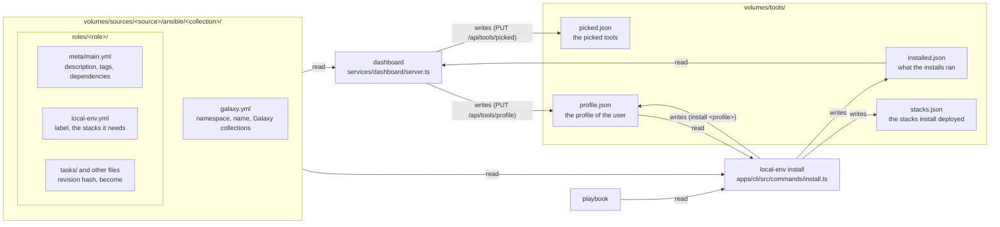
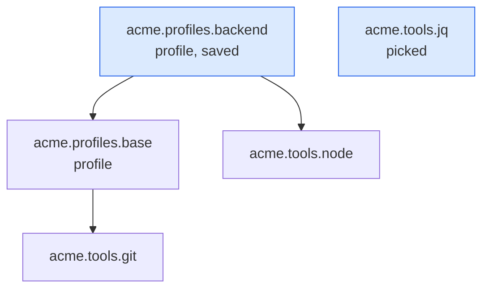
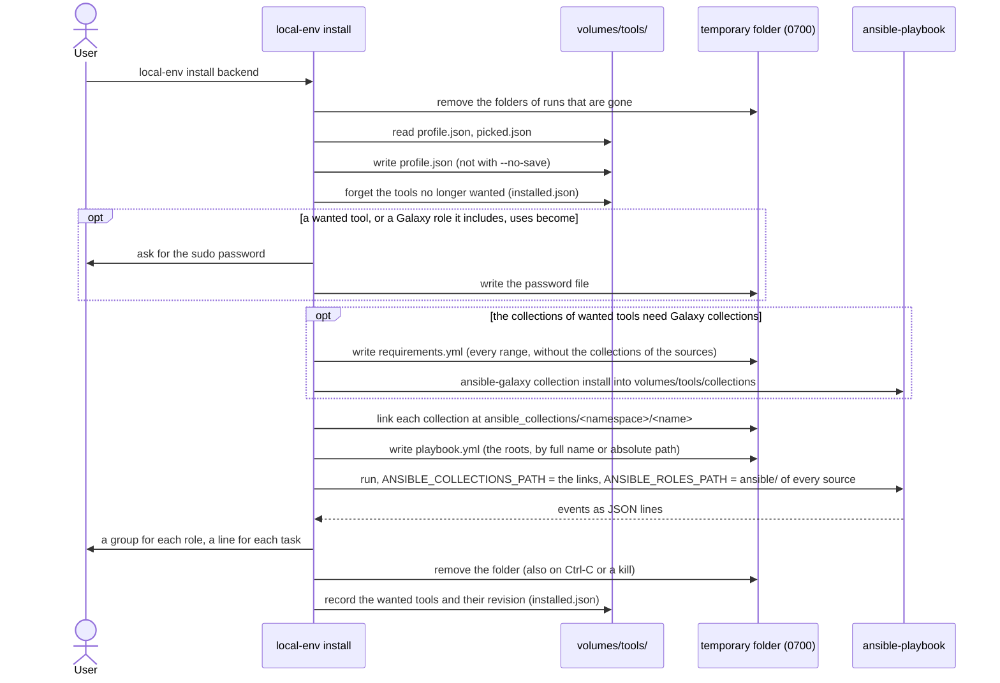
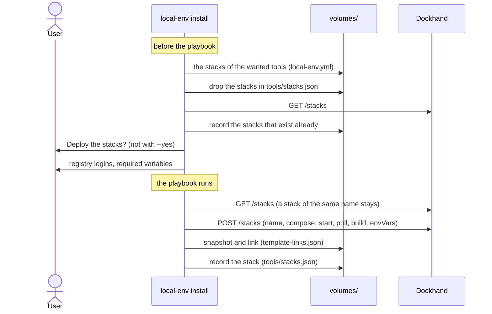

# Tools and profiles

Status: done. Tools, profiles, the Profiles page of the dashboard and the stacks
that tools need.

## What it does

A **tool** is an Ansible role in a source. The roles are grouped in Ansible
collections: `ansible/<collection>/galaxy.yml` gives the namespace and the name
of the collection, and its roles are in `ansible/<collection>/roles/<role>/`.
The full name of a role is `<namespace>.<collection>.<role>`. A folder of
`ansible/` without `galaxy.yml` is a plain role, named by its folder. A
**profile** is a tool that is a set of other tools. The user installs tools and
profiles on the Mac with `local-env install`.

- The Tools page of the dashboard lists the tools of every source. The user
  picks tools there with a switch. Picking a tool does not install it.
- The Tools and Profiles pages have an **Install** button
  (`features/tools/install-button/`). When the next `local-env install` has
  something to do, the button is primary, with the count: the tools to install
  or update, and the unpicked tools that it forgets. The Tools item of the
  sidebar shows the same count, on every page. The button then opens a dialog:
  the tools by profile and by pick, the unpicked ones, the command to copy, and
  the tools that use sudo (`features/tools/install-dialog/`). When the dashboard
  agent runs, the dialog's **Install** runs `local-env install` on the Mac and
  shows it in a terminal ([Dashboard terminal](dashboard-terminal.md)). With
  nothing to do, the button runs the install at once.
- `local-env install` installs the picked tools and the profile of the user. If
  the user has no profile and picked no tools, it asks for a profile in a
  terminal, with a select. It saves the profile (not with `--no-save`) and
  installs it. "No profile", or no terminal, shows the command and the URL of
  the Tools page.
- `local-env install <profile>` saves this profile as the profile of the user,
  then installs it. Later, `local-env install` installs it again with the picked
  tools. If the user has another profile saved, the CLI asks first ("Switch your
  profile from Backend to Frontend?"). Answering no changes nothing and installs
  nothing. Without a terminal, the CLI does not switch, unless `--yes`.
- `local-env install <profile> --no-save` installs the profile one time. The
  saved profile does not change.
- The user names a profile by its short name (`backend`) or its full name
  (`acme.profiles.backend`). If several profiles have this short name, the CLI
  asks for the full name. Only plain roles of the same name in two sources share
  a full name: the user writes `<source>/<name>`. The label is not a name to
  type: it can be a sentence. The CLI shows the name to type beside the label.
- The dashboard and the CLI show the `label` of the role's `local-env.yml`, or
  else the folder name of the role, title-cased: `git_extras` shows as
  `Git Extras`. A brand name (`TablePlus`) needs a label.
- local-env never uninstalls. When a tool is no longer wanted, it stays on the
  Mac. local-env removes it from the list of installed tools and shows a message
  ("No longer wanted, still on this Mac").
- The Profiles page of the dashboard (`/profiles`) lists every profile, with a
  search, a source filter and pages for hundreds of them. A card at the top
  shows the current profile: its tools to install and its stacks to deploy. A
  side panel shows all that a profile brings before the user picks it. The "Use"
  button saves the profile.
- The very bottom of the sidebar shows the current profile, or "No profile",
  under the version (`features/layout/nav-profile/`), where sidebar-07 puts who
  you are. It opens the Profiles page. If the sources have no profile, it is not
  there.
- On the Tools page, the roles of the profile show a locked switch ("In the
  backend profile"). The profiles are not rows of the Tools page.
- A role can need Docker stacks (`local-env.yml`). `local-env install` deploys
  the stacks that are missing, after one confirmation (`--yes` does not ask). It
  deploys each stack one time. If the user removes the stack, it stays removed.

A profile is a plain Ansible role. The tag `profile` in `galaxy_tags` marks it.
Its dependencies are the tools and profiles that it contains:

```yaml
# ansible/profiles/roles/backend/meta/main.yml
galaxy_info:
  description: Backend developer setup
  galaxy_tags: [profile]
dependencies:
  - acme.profiles.base # another profile
  - acme.runtimes.node
```

## How it works

### The files



`services/dashboard/tools.ts` reads and writes these files. The dashboard and
the CLI both use it, so they read the files the same way. The id of a role is
`<source>/<full name>`. `picked.json` holds the ids of the picks. A pick whose
role is no longer in a source stays there, so the user can unpick it.

### What `local-env install` runs

The **roots** are the profile and the picked tools. The **wanted** tools are the
roots and all the tools that they include, at all depths. A dependency is found
by its name, in all the sources, as Ansible finds it: by its full name, or by
its short name in the collection of the role that names it.



In this example, the roots are `backend` and `jq`. The wanted tools are
`backend`, `base`, `git`, `node` and `jq`. The playbook names only the roots.
Ansible runs the dependencies itself.

`services/dashboard/role-graph.ts` finds the wanted tools (`includedRoles`,
`wantedRoles`). The module imports nothing, so the browser can load it too. The
dashboard and the CLI use the same code.

### One install



- `apps/cli/src/core/tools.ts` finds the profile, forgets the tools and runs the
  playbook.
- Ansible finds a collection only in an `ansible_collections/<namespace>/<name>`
  folder. The CLI links each collection of the sources there, in the temporary
  folder. `ANSIBLE_COLLECTIONS_PATH` is this folder, then
  `volumes/tools/collections`, and nothing else: not `~/.ansible/collections`
  and not the user's own `ANSIBLE_COLLECTIONS_PATH`. Ansible still adds the
  collections of the `ansible` package.
- A collection lists the Galaxy collections that it needs in the `dependencies`
  of its `galaxy.yml`. Before the password and the playbook, the CLI installs
  those of the collections of the wanted tools, with
  `ansible-galaxy collection install -r requirements.yml`
  (`apps/cli/src/core/galaxy-collections.ts`). One file holds every range, so
  that the resolver finds a version that meets them all. The collections of the
  sources are left out. `ANSIBLE_COLLECTIONS_PATH` is only
  `volumes/tools/collections`, so `ansible-galaxy` installs there. It skips a
  collection that is there already, or in the `ansible` package. If the install
  fails, the CLI stops before the playbook and names each collection and the
  `galaxy.yml` that asks for it.
- The CLI then reads the installed Galaxy roles that the wanted tools include,
  and their dependencies, for `become`.
- The playbook names a role of a collection by its full name, so that Ansible
  runs it in its collection. It names a plain role by its absolute path.
- `apps/cli/src/core/playbook-output.ts` shows the events of Ansible with clack.
  `install --verbose` shows the output of Ansible itself.
- A task with `become: true` (or `yes`) in a wanted tool makes the CLI ask for
  the password. Ansible reads it from `ANSIBLE_BECOME_PASSWORD_FILE`.
- `apps/cli/src/core/run-folder.ts` makes the temporary folder
  (`$TMPDIR/local-env-install-*`). The folder holds a `pid` file. On SIGINT,
  SIGTERM or SIGHUP, the CLI stops Ansible, removes the folder and exits (130,
  143 or 129). At the start of each run, the CLI removes the folders whose
  process is gone.
- If a picked tool is no longer in a source, the CLI unpicks it. If the saved
  profile is no longer in a source, the CLI clears it.

### The stacks that tools need



- `apps/cli/src/providers/docker/required-stacks.ts` plans the stacks before the
  playbook and deploys them after it. The user answers all the questions first,
  then the install runs without the user.
- The compose file is the same as the file that `catalog-server` gives to
  Dockhand: `build:` points to the build server and `${HOST_HOME}` is the home
  folder. The name of the stack is the compose `name:`, else the folder.
- The CLI links the stack to its template (`how: 'name'`) and saves the version
  as the base of the three-way merge. `update` and `sources sync` then update
  the stack like a stack from the Templates page of Dockhand.
- A variable in the form `${NAME:?help}` or `${NAME?help}` is required. The CLI
  asks for it. A name with `TOKEN`, `SECRET`, `PASSWORD`, `PASSWD` or `KEY` is
  masked and goes to Dockhand as a secret (`isSecret`).
- If Dockhand does not answer, the CLI installs the tools and only shows a
  message about the stacks.

## Why

- **A button that changes color, not a toast.** A toast on every page covered
  the page and came back after each pick. The button is where the user picks,
  and the sidebar's count is on every page.
- **A profile is a plain Ansible role.** Ansible already resolves dependencies,
  removes duplicates and stops on cycles. A profile that contains another
  profile needs no new code. The role also works without local-env.
- **A tag marks the profile, not a folder.** `galaxy_tags` is a field of
  Ansible. A profile is a role of a collection, like the others.
- **Roles are in collections.** A full name does not clash with a role of
  another source. A collection also installs without local-env, with
  `ansible-galaxy collection install`.
- **local-env reads the files, not the output of an Ansible command.** No
  command of Ansible gives the description, the tags and the dependencies of a
  role: `ansible-doc -t role -l` reads only `meta/argument_specs.yml`. The
  dashboard runs in a container without Ansible. local-env reads only the
  formats that Ansible documents: `galaxy.yml` (`namespace`, `name`), the
  `roles/` folder and `meta/main.yml`. Ansible itself finds the roles when the
  playbook runs.
- **local-env does not use the collections of the user.** A collection in
  `~/.ansible/collections` (installed by hand, for another project) would decide
  which version a profile runs with, so the same profile would run differently
  on each Mac. local-env uses only its own folder and the collections of the
  `ansible` package, which `local-env setup` installs with Homebrew. A role that
  needs a collection lists it in its `galaxy.yml`. The user's own Ansible setup
  does not change.
- **Galaxy collections install into `volumes/tools/collections`, not the run
  folder.** A collection then downloads one time. A second install downloads
  nothing.
- **`install` does not upgrade, `update` does.** A collection stays at the
  version of its first install, so an install does the same thing each time.
  `local-env update`, which refreshes everything, upgrades the Galaxy
  collections of the wanted tools with `ansible-galaxy --upgrade`, after the
  pull of the sources. It runs no playbook: it says to run `local-env install`
  to apply what it upgraded. If Galaxy is out of reach, it warns and the update
  goes on.
- **Only the Galaxy collections of the wanted tools install.** A source can have
  many collections. The user gets only what the tools on the Mac need.
- **The dashboard does not install Galaxy collections.** It runs in a container
  without Ansible: `local-env install` installs them, on the Mac, also when the
  dashboard asks the agent to run it. The dashboard shows a Galaxy role of a
  profile from the `galaxy.yml` of its collection, without its description.
- **The CLI links the collections of the sources, it does not install them.** A
  link takes no time and needs no network. `ansible-galaxy collection install`
  builds and copies the collection, and looks for its dependencies on Galaxy. A
  change to a role then runs at the next install, without an install of the
  collection first.
- **The profile is in `volumes/tools/profile.json`, not in `config.json`.** The
  dashboard can write only to `volumes/tools/` (`compose.yaml`). The Profiles
  page must write the profile.
- **The picks are ids in `picked.json`, not a playbook.** Ansible never runs
  them as they are: `install` adds the profile and removes the picks that the
  profile includes. A list of ids, like `profile.json`, says what the file is.
- **`install` writes its own playbook in a temporary folder.** `picked.json`
  holds only the picks. With `--no-save`, the profile of the run is not the
  saved profile. A temporary playbook holds both cases. It goes in the same
  folder as the password, which only the user can read, and local-env removes it
  after the run.
- **The password folder is removed on signals, not only at the end.** Without a
  signal handler, Ctrl-C ends the process before its `finally` runs. The
  password then stays on the disk. A SIGKILL or a crash cannot be caught, so the
  next run removes the folders of runs whose process is gone. A folder of a run
  that is still active stays: two installs can run at the same time.
- **The playbook names each role one time.** It can name a root by path, and a
  profile names its dependencies by name. Ansible does not see that these are
  the same role, so a pick that the profile includes runs two times.
  `playbookRoots` (`services/dashboard/role-graph.ts`) removes a root that
  another root includes.
- **The temporary playbook uses absolute paths for plain roles.** It is not in
  `volumes/tools/`, so a path relative to the home folder does not work there.
  The output reads the name of the role from the end of the path, so it does not
  change.
- **`--no-save` keeps the saved profile wanted.** A profile that runs one time
  does not replace the saved profile. Without this rule, the next
  `local-env install` installs the tools of the saved profile again, as new.
- **Profiles have their own page, not a view of the Tools page.** A profile
  controls the tools of the Mac and the Docker stacks. It is the setup of the
  user, not one more tool. A dropdown in the sidebar does not work for hundreds
  of profiles, and it cannot show what a profile brings.
- **The CLI asks for the profile, it does not open the dashboard.** The user ran
  a command in the terminal and stays there. A new user, or a user whose profile
  left the sources, gets the same select.
- **local-env never uninstalls.** An Ansible role cannot always undo what it
  did. A tool can also hold data of the user. The user removes it.
- **The dashboard asks the agent to run the install.** The dashboard runs in a
  container. The install needs the Mac, the user and sometimes sudo. The
  dashboard agent is a process on the Mac that runs the real `local-env install`
  in a terminal, so the install is the same from the dashboard and from a
  terminal ([Dashboard terminal](dashboard-terminal.md)).
- **The CLI deploys the stacks, not an Ansible role.** The docker provider of
  the CLI already links the stack to its template, saves the deployed version
  for the three-way merge, rewrites `build:` and asks for registry logins. An
  Ansible role cannot do these steps. Ansible also converges: if the user
  removes a stack, the next run deploys it again.
- **The CLI looks at the names before it creates a stack.** `POST /api/stacks`
  of Dockhand replaces a stack of the same name, and its compose file, without
  an error. The CLI looks before the confirmation, and again just before the
  create, because the playbook can take minutes.
- **`stacks.json` records a stack one time.** A stack that a profile needs is a
  start for the user, not a state to keep. If the user removes it, the CLI does
  not deploy it again. A stack that exists already is recorded too.
- **The stacks are in `volumes/tools/stacks.json`, not in `installed.json`.**
  The keys of `installed.json` are role ids, and the CLI forgets the keys of
  roles that are no longer wanted.

## Limits

- local-env does not uninstall tools.
- A dependency is found by name in all the sources. If two sources have a role
  with this name, local-env records both as wanted. Ansible runs only the first
  one that it finds. If two sources have a collection with the same name, the
  CLI links only the collection of the first source.
- A Galaxy collection that a `galaxy.yml` names by a git URL or a path installs,
  but the dashboard cannot match its roles to it: they show as **Missing**.
- The revision of a tool does not change when a new version of a Galaxy
  collection comes out. Only a change of the range in `galaxy.yml` does.
- The dashboard shows a Galaxy role without its description and its tags: the
  collection is not in the sources.
- The CLI does not read the roles of the collections of the `ansible` package
  for `become`. A role of such a collection that uses sudo fails without the
  password.
- `local-env setup` does not ask for a profile yet.
- When the profile is saved, the dashboard does not install it. The user starts
  the install from the install dialog, or with `local-env install`.
- When profiles are in the sources, the sidebar does not show the domain.
- Only stack templates (`"type": 3`) can be stacks of a tool. Container
  templates have no folder to name them.
- The CLI does not use the `env` entries of a template in `templates.json`. It
  asks only for the required variables of the compose file.
- The dashboard does not show the stacks that `local-env install` deployed.
