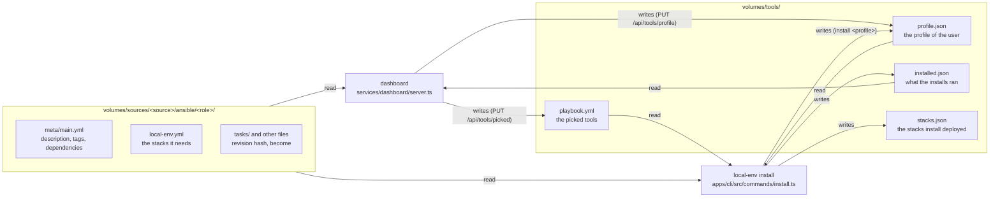
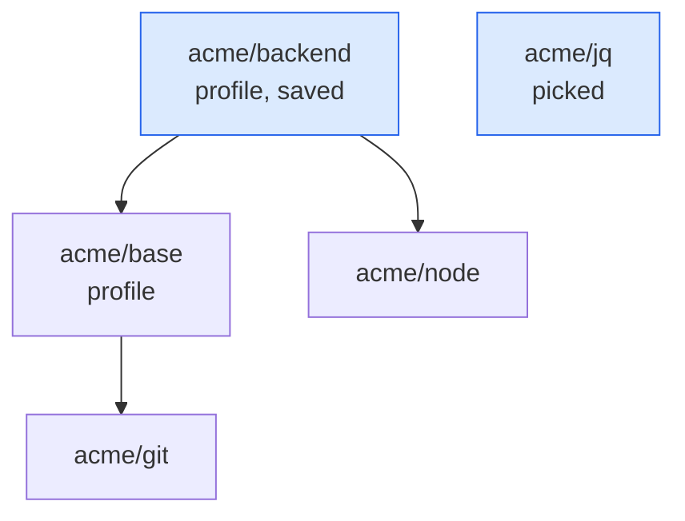
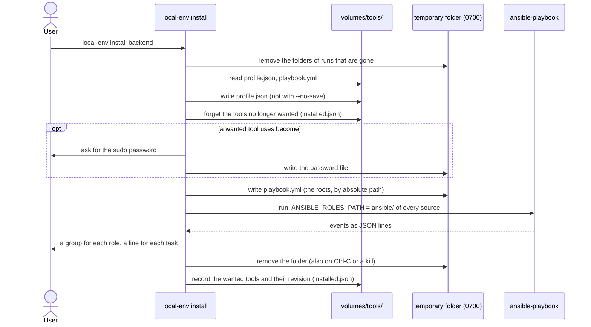
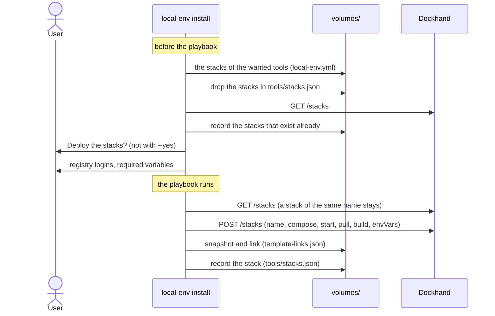

# Tools and profiles

Status: done. Tools, profiles, the profile switcher of the dashboard and the
stacks that tools need.

## What it does

A **tool** is an Ansible role in a source: `ansible/<role>/` in the repo. A
**profile** is a tool that is a set of other tools. The user installs tools and
profiles on the Mac with `local-env install`.

- The Tools page of the dashboard lists the tools of every source. The user
  picks tools there with a switch. The dashboard does not install anything.
- `local-env install` installs the picked tools and the profile of the user.
- `local-env install <profile>` saves this profile as the profile of the user,
  then installs it. Later, `local-env install` installs it again with the picked
  tools.
- `local-env install <profile> --no-save` installs the profile one time. The
  saved profile does not change.
- If two sources have a profile with the same name, the user writes
  `<source>/<profile>`.
- local-env never uninstalls. When a tool is no longer wanted, it stays on the
  Mac. local-env removes it from the list of installed tools and shows a message
  ("No longer wanted, still on this Mac").
- The profile switcher at the top of the sidebar of the dashboard saves the
  profile. On the Tools page, the roles of the profile show a locked switch ("In
  the backend profile"). The profiles are not rows of the Tools page.
- If the sources have no profile, the top of the sidebar shows the logo and the
  domain.
- A role can need Docker stacks (`local-env.yml`). `local-env install` deploys
  the stacks that are missing, after one confirmation (`--yes` does not ask). It
  deploys each stack one time. If the user removes the stack, it stays removed.

A profile is a plain Ansible role. The tag `profile` in `galaxy_tags` marks it.
Its dependencies are the tools and profiles that it contains:

```yaml
# ansible/backend/meta/main.yml
galaxy_info:
  description: Backend developer setup
  galaxy_tags: [profile]
dependencies:
  - base # another profile
  - node
```

## How it works

### The files



`services/dashboard/tools.ts` reads and writes these files. The dashboard and
the CLI both use it, so they read the files the same way.

### What `local-env install` runs

The **roots** are the profile and the picked tools. The **wanted** tools are the
roots and all the tools that they include, at all depths. A dependency is found
by its name, in all the sources, as Ansible finds it.



In this example, the roots are `backend` and `jq`. The wanted tools are
`backend`, `base`, `git`, `node` and `jq`. The playbook names only the roots.
Ansible runs the dependencies itself.

`services/dashboard/role-graph.ts` finds the wanted tools (`includedRoles`,
`wantedRoles`). The module imports nothing, so the browser can load it too. The
dashboard and the CLI use the same code.

### One install



- `apps/cli/src/core/tools.ts` finds the profile, forgets the tools and runs the
  playbook.
- `apps/cli/src/core/playbook-output.ts` shows the events of Ansible with clack.
  `install --verbose` shows the output of Ansible itself.
- A task with `become: true` (or `yes`) in a wanted tool makes the CLI ask for
  the password. Ansible reads it from `ANSIBLE_BECOME_PASSWORD_FILE`.
- `apps/cli/src/core/run-folder.ts` makes the temporary folder
  (`$TMPDIR/local-env-install-*`). The folder holds a `pid` file. On SIGINT,
  SIGTERM or SIGHUP, the CLI stops Ansible, removes the folder and exits (130,
  143 or 129). At the start of each run, the CLI removes the folders whose
  process is gone.
- If a picked tool is no longer in a source, the CLI unpicks it. If the saved
  profile is no longer in a source, the CLI clears it.

### The stacks that tools need



- `apps/cli/src/providers/docker/required-stacks.ts` plans the stacks before the
  playbook and deploys them after it. The user answers all the questions first,
  then the install runs without the user.
- The compose file is the same as the file that `catalog-server` gives to
  Dockhand: `build:` points to the build server and `${HOST_HOME}` is the home
  folder. The name of the stack is the compose `name:`, else the folder.
- The CLI links the stack to its template (`how: 'name'`) and saves the version
  as the base of the three-way merge. `update` and `sources sync` then update
  the stack like a stack from the Templates page of Dockhand.
- A variable in the form `${NAME:?help}` or `${NAME?help}` is required. The CLI
  asks for it. A name with `TOKEN`, `SECRET`, `PASSWORD`, `PASSWD` or `KEY` is
  masked and goes to Dockhand as a secret (`isSecret`).
- If Dockhand does not answer, the CLI installs the tools and only shows a
  message about the stacks.

## Why

- **A profile is a plain Ansible role.** Ansible already resolves dependencies,
  removes duplicates and stops on cycles. A profile that contains another
  profile needs no new code. The role also works without local-env.
- **A tag marks the profile, not a folder.** `galaxy_tags` is a field of
  Ansible. The role stays in `ansible/`, where `ANSIBLE_ROLES_PATH` finds it.
- **The profile is in `volumes/tools/profile.json`, not in `config.json`.** The
  dashboard can write only to `volumes/tools/` (`compose.yaml`). The profile
  switcher must write the profile.
- **`install` writes its own playbook in a temporary folder.** `playbook.yml` is
  the file of the dashboard: it holds only the picks. With `--no-save`, the
  profile of the run is not the saved profile. A temporary playbook holds both
  cases. It goes in the same folder as the password, which only the user can
  read, and local-env removes it after the run.
- **The password folder is removed on signals, not only at the end.** Without a
  signal handler, Ctrl-C ends the process before its `finally` runs. The
  password then stays on the disk. A SIGKILL or a crash cannot be caught, so the
  next run removes the folders of runs whose process is gone. A folder of a run
  that is still active stays: two installs can run at the same time.
- **The playbook names each role one time.** It names the roots by path, and a
  profile names its dependencies by name. Ansible does not see that these are
  the same role, so a pick that the profile includes runs two times.
  `playbookRoots` (`services/dashboard/role-graph.ts`) removes a root that
  another root includes.
- **The temporary playbook uses absolute paths.** It is not in `volumes/tools/`,
  so the relative paths of `playbook.yml` do not work there. The output reads
  the name of the role from the end of the path, so it does not change.
- **`--no-save` keeps the saved profile wanted.** A profile that runs one time
  does not replace the saved profile. Without this rule, the next
  `local-env install` installs the tools of the saved profile again, as new.
- **local-env never uninstalls.** An Ansible role cannot always undo what it
  did. A tool can also hold data of the user. The user removes it.
- **The dashboard runs nothing on the Mac.** It runs in a container. The install
  needs the Mac, the user and sometimes sudo.
- **The CLI deploys the stacks, not an Ansible role.** The docker provider of
  the CLI already links the stack to its template, saves the deployed version
  for the three-way merge, rewrites `build:` and asks for registry logins. An
  Ansible role cannot do these steps. Ansible also converges: if the user
  removes a stack, the next run deploys it again.
- **The CLI looks at the names before it creates a stack.** `POST /api/stacks`
  of Dockhand replaces a stack of the same name, and its compose file, without
  an error. The CLI looks before the confirmation, and again just before the
  create, because the playbook can take minutes.
- **`stacks.json` records a stack one time.** A stack that a profile needs is a
  start for the user, not a state to keep. If the user removes it, the CLI does
  not deploy it again. A stack that exists already is recorded too.
- **The stacks are in `volumes/tools/stacks.json`, not in `installed.json`.**
  The keys of `installed.json` are role ids, and the CLI forgets the keys of
  roles that are no longer wanted.

## Limits

- local-env does not uninstall tools.
- A dependency is found by name in all the sources. If two sources have a role
  with this name, local-env records both as wanted. Ansible runs only the first
  one that it finds in `ANSIBLE_ROLES_PATH`.
- `local-env setup` does not ask for a profile yet.
- When the profile is saved, the dashboard does not install it. The Install
  button gives the `local-env install` command.
- When profiles are in the sources, the sidebar does not show the domain.
- Only stack templates (`"type": 3`) can be stacks of a tool. Container
  templates have no folder to name them.
- The CLI does not use the `env` entries of a template in `templates.json`. It
  asks only for the required variables of the compose file.
- The dashboard does not show the stacks that `local-env install` deployed.
